# PA2 — Use Case Model, Prototype and Traceability

**Owner:** Nguyễn Đức Hưng (@hungstupid) · **Review status:** awaiting peer review.

**Work package:** [Issue #74](https://github.com/hungstupid/CourtMate/issues/74). This handover contains Sections **6, 8 and 9** only, matching the confirmed weekly scope. Section 7 remains in the shared SRS and the teammates’ use-case work packages.

**Source:** [Shared SRS](https://docs.google.com/document/d/1zL3Ra_0LceKOF_2pZa9iWpq7HIbRtALB/edit), snapshot modified 1 November 2026 at 11:38:12 UTC. Section numbering and cross-references follow the complete SRS; this file is a reviewable Markdown transcription of these three sections.

**Baseline changes since Issue #74 was written:** 17 UCs (including UC-17) and 46 FRs (including FR-046); scope remains F01–F10. F08/F09 and UC-15/UC-16 remain Should-have.

**AI assistance:** Codex assisted with consistency checks, wording, Figma evidence inspection and this Markdown/image export. Runtime application tests and independent peer approval are not claimed. The complete SRS AI Usage Log and final submission remain team integration work.

## 6. Use Case Model

### 6.1. Use Case Diagram

Figures 6-1 to 6-4 are complementary views of the same CourtMate system. They use the UC identifiers in Section 6.3. Solid associations identify actor participation; they do not show screen order or the sequence of steps. Authentication and role/ownership checks are preconditions and system responsibilities of protected use cases.

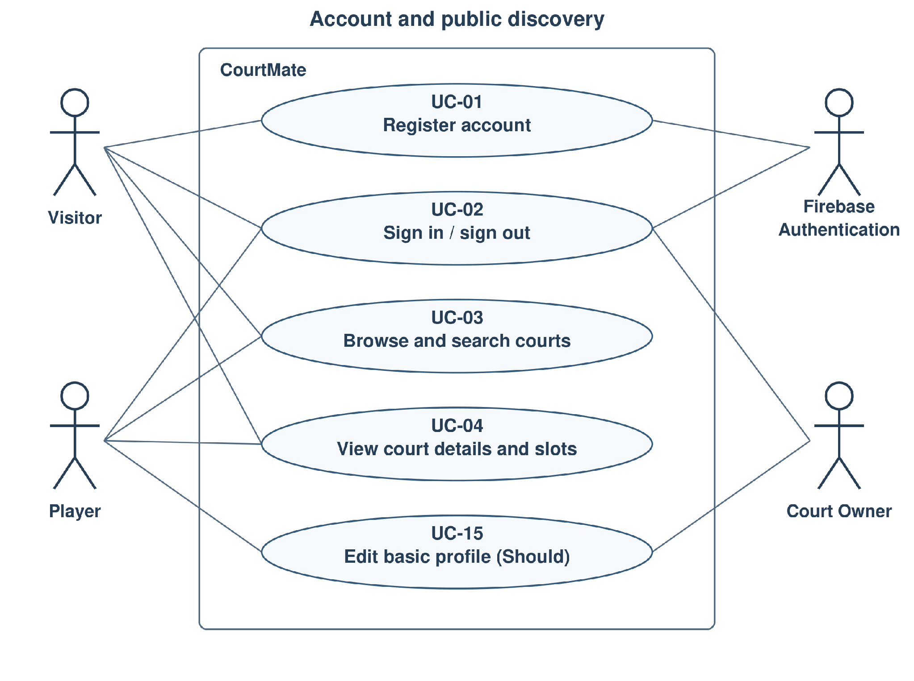

Figure 6-1. Account and public discovery use cases.

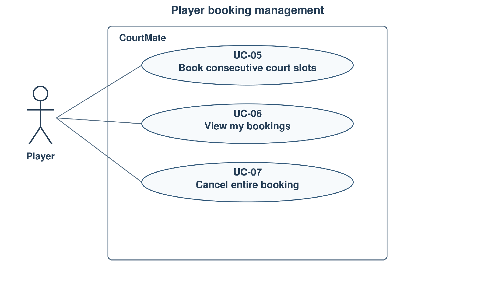

Figure 6-2. Player booking use cases.

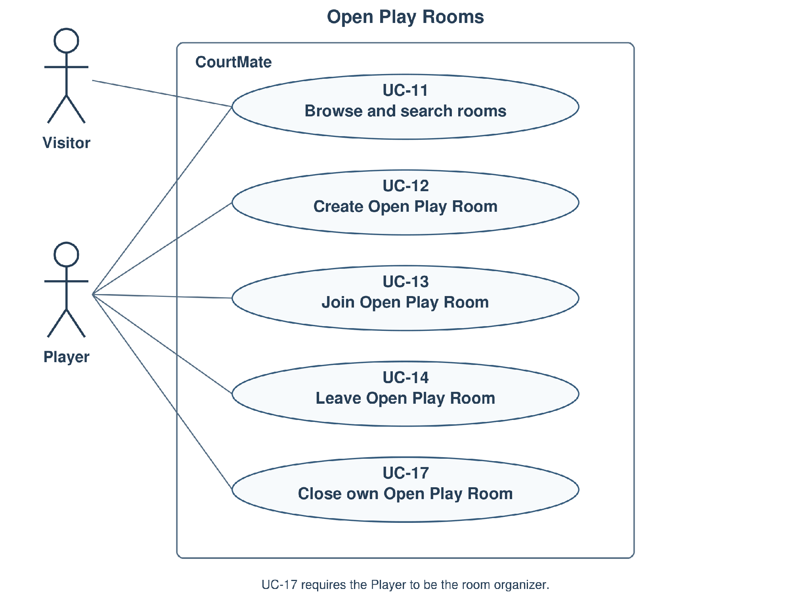

Figure 6-3. Public room discovery and Player room participation use cases.

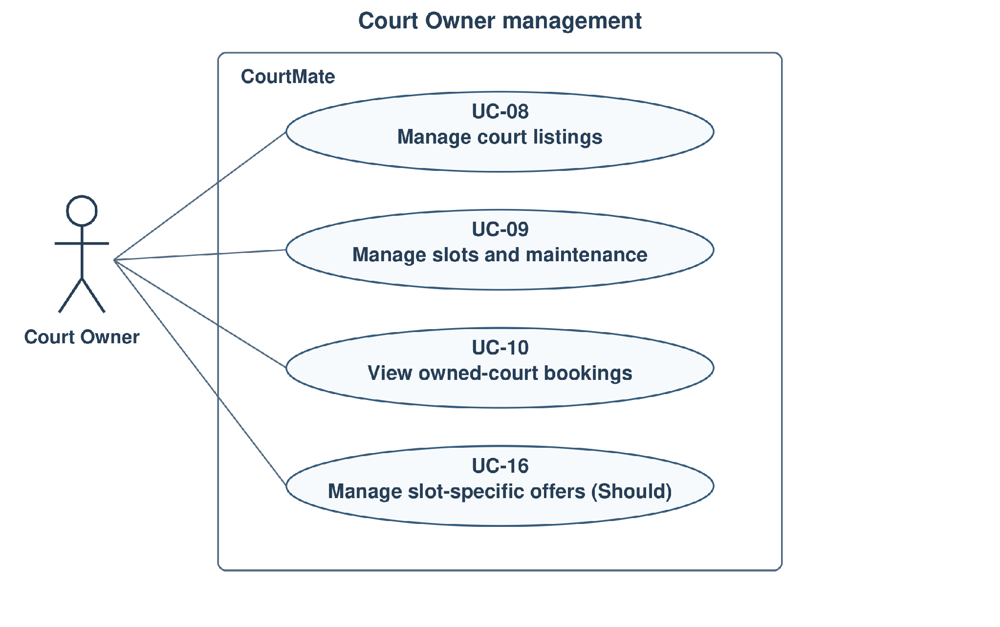

Figure 6-4. Court Owner management use cases.

### 6.2. Actors

| Actor | Description |
| --- | --- |
| Visitor | An unauthenticated person. May register a Player or Court Owner account, sign in, browse/search active courts, view court details and published slots, and browse/search public Open Play Rooms. Protected booking, room participation and court-management actions require the appropriate authenticated role. |
| Player | An authenticated account with the Player role. May book eligible published slots, view/cancel its own bookings, and create/join/leave eligible Open Play Rooms. A Player may close a room only when it is that room's organizer. A Player may also use public discovery features and edit its own basic profile. |
| Court Owner | A registered account assigned the Court Owner role through the registration policy in FR-001/FR-003 and BR-09. May manage only its own court listings, operating hours, dated slots, maintenance and owned-court booking information; may manage slot-specific offers if F09 is delivered, and may edit its own basic profile. |
| Firebase Authentication | The external identity service supporting registration and sign-in/authentication. It is a supporting system actor, not a CourtMate application user role. |

Room Organizer is a contextual relationship between a Player and a room, not a third application role. No Admin dashboard or additional account role is introduced by these use cases.

### 6.3. Use Case List

The model contains 17 use cases: 15 Must-have and 2 Should-have. A use case represents an externally observable user goal. Entering a filter, opening a slot preview, reviewing a selection, and creating a batch of slots are steps within the relevant use case rather than separate use cases. Optional F09 behavior remains Should-have when referenced by a Must-have booking or cancellation use case.

| ID | Use case | Primary actor | Priority | Related FR |
| --- | --- | --- | --- | --- |
| UC-01 | Register Account | Visitor | Must | FR-001, FR-003 |
| UC-02 | Sign In / Sign Out | Visitor (sign in); Player / Court Owner (sign out) | Must | FR-002, FR-004–005 |
| UC-03 | Browse and Search Courts | Visitor / Player | Must | FR-006–009, FR-046 |
| UC-04 | View Court Details and Availability | Visitor / Player | Must | FR-010–012, FR-046; FR-013 (Should) |
| UC-05 | Book Consecutive Court Slots | Player | Must | FR-012, FR-014–018; FR-004–005; FR-044–045 if F09 is delivered |
| UC-06 | View My Bookings | Player | Must | FR-019, FR-021 |
| UC-07 | Cancel Entire Booking | Player | Must | FR-020–022; FR-004–005; FR-043 if F09 is delivered |
| UC-08 | Manage Court Listings | Court Owner | Must | FR-023–024 |
| UC-09 | Manage Slots and Maintenance | Court Owner | Must | FR-025–027 |
| UC-10 | View Owned-Court Bookings | Court Owner | Must | FR-028–030 |
| UC-11 | Browse and Search Open Play Rooms | Visitor / Player | Must | FR-033, FR-037–038 |
| UC-12 | Create Open Play Room | Player | Must | FR-031–033, FR-038, FR-004–005 |
| UC-13 | Join Open Play Room | Player | Must | FR-034–035, FR-038, FR-004–005 |
| UC-14 | Leave Open Play Room | Player (non-organizer member) | Must | FR-036, FR-038 |
| UC-15 | Edit Basic Profile | Player / Court Owner | Should | FR-039–040 |
| UC-16 | Manage Slot-Specific Offers | Court Owner | Should | FR-041–042 |
| UC-17 | Close Own Open Play Room | Player (Room Organizer) | Must | FR-037; FR-004–005 (protected access) |

UC-03 includes the court-name, sport, location and optional time filters, together with the slot preview available from search results. UC-09 includes operating hours, individual/batch slot publication, preview/edit of draft slots, and maintenance. UC-11 includes optional address/area search for the linked court. If F09 is delivered, FR-043 is traced through UC-07 and FR-044–045 through UC-05; UC-16 covers the Owner’s creation/deactivation of offers. FR-046 specifies the search-result slot-preview entry and is traced through UC-03/UC-04; the full availability list remains FR-011.

## 8. Prototype / Mockups

### 8.1. Screen Register and Use Case Mapping

This section covers the 17 use cases in Section 6 through primary screens, supporting states, navigation diagrams and screen specifications. UC-15 and UC-16 remain Should-have. Each linked screen ID opens an existing editable frame in the team Figma file; representative illustrations below are current exports of those frames.

Review fixtures use fixed dates rather than live availability. Ordinary court/room examples use 27–28 October 2026 playing dates and are reviewed before the first slot starts; a reference time of 26 October 2026 10:00 UTC+7 is used for those scenarios. F09 examples use 24 October 2026 10:00 with slots later that day. Cancellation-boundary fixtures use the explicit time shown on their own screen. These are separate scenarios, not a single current server clock.

| Screen | Purpose | Use case(s) | Editable frame |
| --- | --- | --- | --- |
| [S03](https://www.figma.com/design/fR2n35EUsOIvoEWeIqcIbA/SE_FE_Design_CourtMate?node-id=27-242) | Account registration: Player selection | UC-01 | [S03](https://www.figma.com/design/fR2n35EUsOIvoEWeIqcIbA/SE_FE_Design_CourtMate?node-id=27-242) |
| [S151](https://www.figma.com/design/fR2n35EUsOIvoEWeIqcIbA/SE_FE_Design_CourtMate?node-id=181-1638) | Account registration: Court Owner selection | UC-01 | [S151](https://www.figma.com/design/fR2n35EUsOIvoEWeIqcIbA/SE_FE_Design_CourtMate?node-id=181-1638) |
| [S02](https://www.figma.com/design/fR2n35EUsOIvoEWeIqcIbA/SE_FE_Design_CourtMate?node-id=27-134) | Player sign-in | UC-02 | [S02](https://www.figma.com/design/fR2n35EUsOIvoEWeIqcIbA/SE_FE_Design_CourtMate?node-id=27-134) |
| [S04](https://www.figma.com/design/fR2n35EUsOIvoEWeIqcIbA/SE_FE_Design_CourtMate?node-id=27-188) | Court Owner sign-in | UC-02 | [S04](https://www.figma.com/design/fR2n35EUsOIvoEWeIqcIbA/SE_FE_Design_CourtMate?node-id=27-188) |
| [S01](https://www.figma.com/design/fR2n35EUsOIvoEWeIqcIbA/SE_FE_Design_CourtMate?node-id=27-2) | Court search and independent filters | UC-03 | [S01](https://www.figma.com/design/fR2n35EUsOIvoEWeIqcIbA/SE_FE_Design_CourtMate?node-id=27-2) |
| [S191](https://www.figma.com/design/fR2n35EUsOIvoEWeIqcIbA/SE_FE_Design_CourtMate?node-id=196-2104) | Search results retaining criteria | UC-03 | [S191](https://www.figma.com/design/fR2n35EUsOIvoEWeIqcIbA/SE_FE_Design_CourtMate?node-id=196-2104) |
| [D01](https://www.figma.com/design/fR2n35EUsOIvoEWeIqcIbA/SE_FE_Design_CourtMate?node-id=180-1409) | Slot preview from a result card | UC-03 / UC-04 | [D01](https://www.figma.com/design/fR2n35EUsOIvoEWeIqcIbA/SE_FE_Design_CourtMate?node-id=180-1409) |
| [S06](https://www.figma.com/design/fR2n35EUsOIvoEWeIqcIbA/SE_FE_Design_CourtMate?node-id=27-310) | Court details | UC-04 | [S06](https://www.figma.com/design/fR2n35EUsOIvoEWeIqcIbA/SE_FE_Design_CourtMate?node-id=27-310) |
| [S127](https://www.figma.com/design/fR2n35EUsOIvoEWeIqcIbA/SE_FE_Design_CourtMate?node-id=92-1199) | Published daily slots and selection | UC-04 / UC-05 | [S127](https://www.figma.com/design/fR2n35EUsOIvoEWeIqcIbA/SE_FE_Design_CourtMate?node-id=92-1199) |
| [S217](https://www.figma.com/design/fR2n35EUsOIvoEWeIqcIbA/SE_FE_Design_CourtMate?node-id=221-3508) | Review selected slots and total | UC-05 | [S217](https://www.figma.com/design/fR2n35EUsOIvoEWeIqcIbA/SE_FE_Design_CourtMate?node-id=221-3508) |
| [S218](https://www.figma.com/design/fR2n35EUsOIvoEWeIqcIbA/SE_FE_Design_CourtMate?node-id=221-3564) | One booking confirmed | UC-05 | [S218](https://www.figma.com/design/fR2n35EUsOIvoEWeIqcIbA/SE_FE_Design_CourtMate?node-id=221-3564) |
| [S12](https://www.figma.com/design/fR2n35EUsOIvoEWeIqcIbA/SE_FE_Design_CourtMate?node-id=44-122) | My booking history | UC-06 | [S12](https://www.figma.com/design/fR2n35EUsOIvoEWeIqcIbA/SE_FE_Design_CourtMate?node-id=44-122) |
| [S13](https://www.figma.com/design/fR2n35EUsOIvoEWeIqcIbA/SE_FE_Design_CourtMate?node-id=44-241) | Confirm whole-booking cancellation | UC-07 | [S13](https://www.figma.com/design/fR2n35EUsOIvoEWeIqcIbA/SE_FE_Design_CourtMate?node-id=44-241) |
| [S14](https://www.figma.com/design/fR2n35EUsOIvoEWeIqcIbA/SE_FE_Design_CourtMate?node-id=44-283) | Cancellation result | UC-07 | [S14](https://www.figma.com/design/fR2n35EUsOIvoEWeIqcIbA/SE_FE_Design_CourtMate?node-id=44-283) |
| [S30](https://www.figma.com/design/fR2n35EUsOIvoEWeIqcIbA/SE_FE_Design_CourtMate?node-id=44-857) | Owned courts and quick actions | UC-08 | [S30](https://www.figma.com/design/fR2n35EUsOIvoEWeIqcIbA/SE_FE_Design_CourtMate?node-id=44-857) |
| [S31](https://www.figma.com/design/fR2n35EUsOIvoEWeIqcIbA/SE_FE_Design_CourtMate?node-id=44-921) | Create owned court | UC-08 | [S31](https://www.figma.com/design/fR2n35EUsOIvoEWeIqcIbA/SE_FE_Design_CourtMate?node-id=44-921) |
| [S32](https://www.figma.com/design/fR2n35EUsOIvoEWeIqcIbA/SE_FE_Design_CourtMate?node-id=44-979) | Edit owned court | UC-08 | [S32](https://www.figma.com/design/fR2n35EUsOIvoEWeIqcIbA/SE_FE_Design_CourtMate?node-id=44-979) |
| [S33](https://www.figma.com/design/fR2n35EUsOIvoEWeIqcIbA/SE_FE_Design_CourtMate?node-id=44-1040) | Confirm deactivation | UC-08 | [S33](https://www.figma.com/design/fR2n35EUsOIvoEWeIqcIbA/SE_FE_Design_CourtMate?node-id=44-1040) |
| [S34](https://www.figma.com/design/fR2n35EUsOIvoEWeIqcIbA/SE_FE_Design_CourtMate?node-id=44-1070) | Daily court calendar | UC-09 | [S34](https://www.figma.com/design/fR2n35EUsOIvoEWeIqcIbA/SE_FE_Design_CourtMate?node-id=44-1070) |
| [S201](https://www.figma.com/design/fR2n35EUsOIvoEWeIqcIbA/SE_FE_Design_CourtMate?node-id=221-2490) | Configure multiple dated slots | UC-09 | [S201](https://www.figma.com/design/fR2n35EUsOIvoEWeIqcIbA/SE_FE_Design_CourtMate?node-id=221-2490) |
| [S202](https://www.figma.com/design/fR2n35EUsOIvoEWeIqcIbA/SE_FE_Design_CourtMate?node-id=221-2554) | Preview and edit draft slot rows | UC-09 | [S202](https://www.figma.com/design/fR2n35EUsOIvoEWeIqcIbA/SE_FE_Design_CourtMate?node-id=221-2554) |
| [S203](https://www.figma.com/design/fR2n35EUsOIvoEWeIqcIbA/SE_FE_Design_CourtMate?node-id=221-2618) | Published slot calendar | UC-09 | [S203](https://www.figma.com/design/fR2n35EUsOIvoEWeIqcIbA/SE_FE_Design_CourtMate?node-id=221-2618) |
| [S206](https://www.figma.com/design/fR2n35EUsOIvoEWeIqcIbA/SE_FE_Design_CourtMate?node-id=221-2810) | Edit one AVAILABLE/draft slot | UC-09 | [S206](https://www.figma.com/design/fR2n35EUsOIvoEWeIqcIbA/SE_FE_Design_CourtMate?node-id=221-2810) |
| [S35](https://www.figma.com/design/fR2n35EUsOIvoEWeIqcIbA/SE_FE_Design_CourtMate?node-id=44-1123) | Configure maintenance interval | UC-09 | [S35](https://www.figma.com/design/fR2n35EUsOIvoEWeIqcIbA/SE_FE_Design_CourtMate?node-id=44-1123) |
| [S208](https://www.figma.com/design/fR2n35EUsOIvoEWeIqcIbA/SE_FE_Design_CourtMate?node-id=221-2938) | Preview maintenance impact | UC-09 | [S208](https://www.figma.com/design/fR2n35EUsOIvoEWeIqcIbA/SE_FE_Design_CourtMate?node-id=221-2938) |
| [S38](https://www.figma.com/design/fR2n35EUsOIvoEWeIqcIbA/SE_FE_Design_CourtMate?node-id=44-1234) | Bookings for owned courts | UC-10 | [S38](https://www.figma.com/design/fR2n35EUsOIvoEWeIqcIbA/SE_FE_Design_CourtMate?node-id=44-1234) |
| [S39](https://www.figma.com/design/fR2n35EUsOIvoEWeIqcIbA/SE_FE_Design_CourtMate?node-id=44-1281) | Owned-court booking detail | UC-10 | [S39](https://www.figma.com/design/fR2n35EUsOIvoEWeIqcIbA/SE_FE_Design_CourtMate?node-id=44-1281) |
| [S20](https://www.figma.com/design/fR2n35EUsOIvoEWeIqcIbA/SE_FE_Design_CourtMate?node-id=44-445) | Search public rooms by court location | UC-11 | [S20](https://www.figma.com/design/fR2n35EUsOIvoEWeIqcIbA/SE_FE_Design_CourtMate?node-id=44-445) |
| [S21](https://www.figma.com/design/fR2n35EUsOIvoEWeIqcIbA/SE_FE_Design_CourtMate?node-id=44-499) | Public room details | UC-11 / UC-13 | [S21](https://www.figma.com/design/fR2n35EUsOIvoEWeIqcIbA/SE_FE_Design_CourtMate?node-id=44-499) |
| [S25](https://www.figma.com/design/fR2n35EUsOIvoEWeIqcIbA/SE_FE_Design_CourtMate?node-id=44-679) | Create room from eligible owned booking | UC-12 | [S25](https://www.figma.com/design/fR2n35EUsOIvoEWeIqcIbA/SE_FE_Design_CourtMate?node-id=44-679) |
| [S26](https://www.figma.com/design/fR2n35EUsOIvoEWeIqcIbA/SE_FE_Design_CourtMate?node-id=44-728) | Created organizer room | UC-12 / UC-17 | [S26](https://www.figma.com/design/fR2n35EUsOIvoEWeIqcIbA/SE_FE_Design_CourtMate?node-id=44-728) |
| [S22](https://www.figma.com/design/fR2n35EUsOIvoEWeIqcIbA/SE_FE_Design_CourtMate?node-id=44-555) | Joined room / FULL sample | UC-13 | [S22](https://www.figma.com/design/fR2n35EUsOIvoEWeIqcIbA/SE_FE_Design_CourtMate?node-id=44-555) |
| [S23](https://www.figma.com/design/fR2n35EUsOIvoEWeIqcIbA/SE_FE_Design_CourtMate?node-id=44-603) | Confirm leaving a room | UC-14 | [S23](https://www.figma.com/design/fR2n35EUsOIvoEWeIqcIbA/SE_FE_Design_CourtMate?node-id=44-603) |
| [S155](https://www.figma.com/design/fR2n35EUsOIvoEWeIqcIbA/SE_FE_Design_CourtMate?node-id=182-2012) | Organizer room with current members | UC-17 | [S155](https://www.figma.com/design/fR2n35EUsOIvoEWeIqcIbA/SE_FE_Design_CourtMate?node-id=182-2012) |
| [S153](https://www.figma.com/design/fR2n35EUsOIvoEWeIqcIbA/SE_FE_Design_CourtMate?node-id=182-1935) | Confirm manual room closure | UC-17 | [S153](https://www.figma.com/design/fR2n35EUsOIvoEWeIqcIbA/SE_FE_Design_CourtMate?node-id=182-1935) |
| [S154](https://www.figma.com/design/fR2n35EUsOIvoEWeIqcIbA/SE_FE_Design_CourtMate?node-id=182-1971) | Manually CLOSED room | UC-17 | [S154](https://www.figma.com/design/fR2n35EUsOIvoEWeIqcIbA/SE_FE_Design_CourtMate?node-id=182-1971) |
| [S46](https://www.figma.com/design/fR2n35EUsOIvoEWeIqcIbA/SE_FE_Design_CourtMate?node-id=44-1538) | Basic profile | UC-15 | [S46](https://www.figma.com/design/fR2n35EUsOIvoEWeIqcIbA/SE_FE_Design_CourtMate?node-id=44-1538) |
| [S42](https://www.figma.com/design/fR2n35EUsOIvoEWeIqcIbA/SE_FE_Design_CourtMate?node-id=44-1393) | Owned slot-specific offers | UC-16 | [S42](https://www.figma.com/design/fR2n35EUsOIvoEWeIqcIbA/SE_FE_Design_CourtMate?node-id=44-1393) |
| [S43](https://www.figma.com/design/fR2n35EUsOIvoEWeIqcIbA/SE_FE_Design_CourtMate?node-id=44-1433) | Create an eligible offer | UC-16 | [S43](https://www.figma.com/design/fR2n35EUsOIvoEWeIqcIbA/SE_FE_Design_CourtMate?node-id=44-1433) |
| [S220](https://www.figma.com/design/fR2n35EUsOIvoEWeIqcIbA/SE_FE_Design_CourtMate?node-id=221-3684) | Confirm offer deactivation | UC-16 | [S220](https://www.figma.com/design/fR2n35EUsOIvoEWeIqcIbA/SE_FE_Design_CourtMate?node-id=221-3684) |

Supporting states and responsive variants

| Family | Verified frame links |
| --- | --- |
| Account success and access failures | [S05](https://www.figma.com/design/fR2n35EUsOIvoEWeIqcIbA/SE_FE_Design_CourtMate?node-id=27-284), [S152](https://www.figma.com/design/fR2n35EUsOIvoEWeIqcIbA/SE_FE_Design_CourtMate?node-id=181-1682), [S17](https://www.figma.com/design/fR2n35EUsOIvoEWeIqcIbA/SE_FE_Design_CourtMate?node-id=44-365), [S18](https://www.figma.com/design/fR2n35EUsOIvoEWeIqcIbA/SE_FE_Design_CourtMate?node-id=44-393), [S19](https://www.figma.com/design/fR2n35EUsOIvoEWeIqcIbA/SE_FE_Design_CourtMate?node-id=44-419), [S49](https://www.figma.com/design/fR2n35EUsOIvoEWeIqcIbA/SE_FE_Design_CourtMate?node-id=44-1640), [S77](https://www.figma.com/design/fR2n35EUsOIvoEWeIqcIbA/SE_FE_Design_CourtMate?node-id=44-2935) |
| Search/preview variants and empty/error states | [S192](https://www.figma.com/design/fR2n35EUsOIvoEWeIqcIbA/SE_FE_Design_CourtMate?node-id=196-2264), [S193](https://www.figma.com/design/fR2n35EUsOIvoEWeIqcIbA/SE_FE_Design_CourtMate?node-id=196-2437), [S194](https://www.figma.com/design/fR2n35EUsOIvoEWeIqcIbA/SE_FE_Design_CourtMate?node-id=196-2563), [S149](https://www.figma.com/design/fR2n35EUsOIvoEWeIqcIbA/SE_FE_Design_CourtMate?node-id=180-1663), [S150](https://www.figma.com/design/fR2n35EUsOIvoEWeIqcIbA/SE_FE_Design_CourtMate?node-id=180-1704), [S50](https://www.figma.com/design/fR2n35EUsOIvoEWeIqcIbA/SE_FE_Design_CourtMate?node-id=44-1668), [S51](https://www.figma.com/design/fR2n35EUsOIvoEWeIqcIbA/SE_FE_Design_CourtMate?node-id=44-1704), [S52](https://www.figma.com/design/fR2n35EUsOIvoEWeIqcIbA/SE_FE_Design_CourtMate?node-id=44-1726), [D04](https://www.figma.com/design/fR2n35EUsOIvoEWeIqcIbA/SE_FE_Design_CourtMate?node-id=180-1499), [D05](https://www.figma.com/design/fR2n35EUsOIvoEWeIqcIbA/SE_FE_Design_CourtMate?node-id=180-1523), [D06](https://www.figma.com/design/fR2n35EUsOIvoEWeIqcIbA/SE_FE_Design_CourtMate?node-id=180-1553), [D07](https://www.figma.com/design/fR2n35EUsOIvoEWeIqcIbA/SE_FE_Design_CourtMate?node-id=180-1583), [D08](https://www.figma.com/design/fR2n35EUsOIvoEWeIqcIbA/SE_FE_Design_CourtMate?node-id=180-1741), [D09](https://www.figma.com/design/fR2n35EUsOIvoEWeIqcIbA/SE_FE_Design_CourtMate?node-id=180-1750), [D10](https://www.figma.com/design/fR2n35EUsOIvoEWeIqcIbA/SE_FE_Design_CourtMate?node-id=180-1756) |
| Booking conflict, repricing and boundary fixtures | [S10](https://www.figma.com/design/fR2n35EUsOIvoEWeIqcIbA/SE_FE_Design_CourtMate?node-id=27-534), [S11](https://www.figma.com/design/fR2n35EUsOIvoEWeIqcIbA/SE_FE_Design_CourtMate?node-id=27-560), [S16](https://www.figma.com/design/fR2n35EUsOIvoEWeIqcIbA/SE_FE_Design_CourtMate?node-id=44-339), [S70](https://www.figma.com/design/fR2n35EUsOIvoEWeIqcIbA/SE_FE_Design_CourtMate?node-id=44-2009), [S75](https://www.figma.com/design/fR2n35EUsOIvoEWeIqcIbA/SE_FE_Design_CourtMate?node-id=44-2856), [S137](https://www.figma.com/design/fR2n35EUsOIvoEWeIqcIbA/SE_FE_Design_CourtMate?node-id=96-1276), [S138](https://www.figma.com/design/fR2n35EUsOIvoEWeIqcIbA/SE_FE_Design_CourtMate?node-id=96-1314), [S239](https://www.figma.com/design/fR2n35EUsOIvoEWeIqcIbA/SE_FE_Design_CourtMate?node-id=232-3526) |
| Cancellation and linked-room outcomes | [S15](https://www.figma.com/design/fR2n35EUsOIvoEWeIqcIbA/SE_FE_Design_CourtMate?node-id=44-313), [S100](https://www.figma.com/design/fR2n35EUsOIvoEWeIqcIbA/SE_FE_Design_CourtMate?node-id=46-876), [S131](https://www.figma.com/design/fR2n35EUsOIvoEWeIqcIbA/SE_FE_Design_CourtMate?node-id=94-1236), [S132](https://www.figma.com/design/fR2n35EUsOIvoEWeIqcIbA/SE_FE_Design_CourtMate?node-id=94-1262), [S134](https://www.figma.com/design/fR2n35EUsOIvoEWeIqcIbA/SE_FE_Design_CourtMate?node-id=95-1275), [S135](https://www.figma.com/design/fR2n35EUsOIvoEWeIqcIbA/SE_FE_Design_CourtMate?node-id=95-1301), [S136](https://www.figma.com/design/fR2n35EUsOIvoEWeIqcIbA/SE_FE_Design_CourtMate?node-id=95-1327) |
| Court input, capacity and deactivation states | [S41](https://www.figma.com/design/fR2n35EUsOIvoEWeIqcIbA/SE_FE_Design_CourtMate?node-id=44-1358), [S129](https://www.figma.com/design/fR2n35EUsOIvoEWeIqcIbA/SE_FE_Design_CourtMate?node-id=93-1217), [S140](https://www.figma.com/design/fR2n35EUsOIvoEWeIqcIbA/SE_FE_Design_CourtMate?node-id=96-1384), [S219](https://www.figma.com/design/fR2n35EUsOIvoEWeIqcIbA/SE_FE_Design_CourtMate?node-id=221-3620), [S221](https://www.figma.com/design/fR2n35EUsOIvoEWeIqcIbA/SE_FE_Design_CourtMate?node-id=221-3748), [S222](https://www.figma.com/design/fR2n35EUsOIvoEWeIqcIbA/SE_FE_Design_CourtMate?node-id=221-3812), [S233](https://www.figma.com/design/fR2n35EUsOIvoEWeIqcIbA/SE_FE_Design_CourtMate?node-id=229-2968), [S234](https://www.figma.com/design/fR2n35EUsOIvoEWeIqcIbA/SE_FE_Design_CourtMate?node-id=229-3133), [S235](https://www.figma.com/design/fR2n35EUsOIvoEWeIqcIbA/SE_FE_Design_CourtMate?node-id=229-3298) |
| Slot add/edit, hours and protected booking states | [S200](https://www.figma.com/design/fR2n35EUsOIvoEWeIqcIbA/SE_FE_Design_CourtMate?node-id=221-2426), [S204](https://www.figma.com/design/fR2n35EUsOIvoEWeIqcIbA/SE_FE_Design_CourtMate?node-id=221-2682), [S205](https://www.figma.com/design/fR2n35EUsOIvoEWeIqcIbA/SE_FE_Design_CourtMate?node-id=221-2746), [S207](https://www.figma.com/design/fR2n35EUsOIvoEWeIqcIbA/SE_FE_Design_CourtMate?node-id=221-2874), [S210](https://www.figma.com/design/fR2n35EUsOIvoEWeIqcIbA/SE_FE_Design_CourtMate?node-id=221-3066), [S211](https://www.figma.com/design/fR2n35EUsOIvoEWeIqcIbA/SE_FE_Design_CourtMate?node-id=221-3130), [S157](https://www.figma.com/design/fR2n35EUsOIvoEWeIqcIbA/SE_FE_Design_CourtMate?node-id=182-2110), [S158](https://www.figma.com/design/fR2n35EUsOIvoEWeIqcIbA/SE_FE_Design_CourtMate?node-id=182-2151) |
| Maintenance and owner-only booking access | [S36](https://www.figma.com/design/fR2n35EUsOIvoEWeIqcIbA/SE_FE_Design_CourtMate?node-id=44-1174), [S209](https://www.figma.com/design/fR2n35EUsOIvoEWeIqcIbA/SE_FE_Design_CourtMate?node-id=221-3002), [S240](https://www.figma.com/design/fR2n35EUsOIvoEWeIqcIbA/SE_FE_Design_CourtMate?node-id=232-3600), [S40](https://www.figma.com/design/fR2n35EUsOIvoEWeIqcIbA/SE_FE_Design_CourtMate?node-id=44-1331), [S232](https://www.figma.com/design/fR2n35EUsOIvoEWeIqcIbA/SE_FE_Design_CourtMate?node-id=227-3149) |
| Room search, guest, capacity and lifecycle states | [S94](https://www.figma.com/design/fR2n35EUsOIvoEWeIqcIbA/SE_FE_Design_CourtMate?node-id=44-3445), [S212](https://www.figma.com/design/fR2n35EUsOIvoEWeIqcIbA/SE_FE_Design_CourtMate?node-id=221-3194), [S230](https://www.figma.com/design/fR2n35EUsOIvoEWeIqcIbA/SE_FE_Design_CourtMate?node-id=224-2822), [S231](https://www.figma.com/design/fR2n35EUsOIvoEWeIqcIbA/SE_FE_Design_CourtMate?node-id=224-2899), [S27](https://www.figma.com/design/fR2n35EUsOIvoEWeIqcIbA/SE_FE_Design_CourtMate?node-id=44-773), [S29](https://www.figma.com/design/fR2n35EUsOIvoEWeIqcIbA/SE_FE_Design_CourtMate?node-id=44-831), [S63](https://www.figma.com/design/fR2n35EUsOIvoEWeIqcIbA/SE_FE_Design_CourtMate?node-id=44-1851), [S78](https://www.figma.com/design/fR2n35EUsOIvoEWeIqcIbA/SE_FE_Design_CourtMate?node-id=44-2973), [S79](https://www.figma.com/design/fR2n35EUsOIvoEWeIqcIbA/SE_FE_Design_CourtMate?node-id=44-3011), [S145](https://www.figma.com/design/fR2n35EUsOIvoEWeIqcIbA/SE_FE_Design_CourtMate?node-id=110-1358), [S146](https://www.figma.com/design/fR2n35EUsOIvoEWeIqcIbA/SE_FE_Design_CourtMate?node-id=110-1407) |
| Manual close with FULL/other member samples | [S175](https://www.figma.com/design/fR2n35EUsOIvoEWeIqcIbA/SE_FE_Design_CourtMate?node-id=185-2059), [S176](https://www.figma.com/design/fR2n35EUsOIvoEWeIqcIbA/SE_FE_Design_CourtMate?node-id=186-2263), [S177](https://www.figma.com/design/fR2n35EUsOIvoEWeIqcIbA/SE_FE_Design_CourtMate?node-id=186-2289), [S186](https://www.figma.com/design/fR2n35EUsOIvoEWeIqcIbA/SE_FE_Design_CourtMate?node-id=190-1965), [S187](https://www.figma.com/design/fR2n35EUsOIvoEWeIqcIbA/SE_FE_Design_CourtMate?node-id=190-2014), [S169](https://www.figma.com/design/fR2n35EUsOIvoEWeIqcIbA/SE_FE_Design_CourtMate?node-id=185-1881), [S170](https://www.figma.com/design/fR2n35EUsOIvoEWeIqcIbA/SE_FE_Design_CourtMate?node-id=185-1907), [S171](https://www.figma.com/design/fR2n35EUsOIvoEWeIqcIbA/SE_FE_Design_CourtMate?node-id=185-1940), [S172](https://www.figma.com/design/fR2n35EUsOIvoEWeIqcIbA/SE_FE_Design_CourtMate?node-id=185-1966), [S173](https://www.figma.com/design/fR2n35EUsOIvoEWeIqcIbA/SE_FE_Design_CourtMate?node-id=185-1999), [S174](https://www.figma.com/design/fR2n35EUsOIvoEWeIqcIbA/SE_FE_Design_CourtMate?node-id=185-2025) |
| Profile validation and optional F09 cases | [S47](https://www.figma.com/design/fR2n35EUsOIvoEWeIqcIbA/SE_FE_Design_CourtMate?node-id=44-1584), [S48](https://www.figma.com/design/fR2n35EUsOIvoEWeIqcIbA/SE_FE_Design_CourtMate?node-id=44-1609), [S76](https://www.figma.com/design/fR2n35EUsOIvoEWeIqcIbA/SE_FE_Design_CourtMate?node-id=44-2892), [S44](https://www.figma.com/design/fR2n35EUsOIvoEWeIqcIbA/SE_FE_Design_CourtMate?node-id=44-1484), [S159](https://www.figma.com/design/fR2n35EUsOIvoEWeIqcIbA/SE_FE_Design_CourtMate?node-id=182-2189), [S160](https://www.figma.com/design/fR2n35EUsOIvoEWeIqcIbA/SE_FE_Design_CourtMate?node-id=182-2227), [S120](https://www.figma.com/design/fR2n35EUsOIvoEWeIqcIbA/SE_FE_Design_CourtMate?node-id=51-1029), [S121](https://www.figma.com/design/fR2n35EUsOIvoEWeIqcIbA/SE_FE_Design_CourtMate?node-id=52-1038), [S133](https://www.figma.com/design/fR2n35EUsOIvoEWeIqcIbA/SE_FE_Design_CourtMate?node-id=95-1249), [S138](https://www.figma.com/design/fR2n35EUsOIvoEWeIqcIbA/SE_FE_Design_CourtMate?node-id=96-1314) |
| Phone/tablet task variants | [S56](https://www.figma.com/design/fR2n35EUsOIvoEWeIqcIbA/SE_FE_Design_CourtMate?node-id=44-2478), [S60](https://www.figma.com/design/fR2n35EUsOIvoEWeIqcIbA/SE_FE_Design_CourtMate?node-id=44-2567), [S161](https://www.figma.com/design/fR2n35EUsOIvoEWeIqcIbA/SE_FE_Design_CourtMate?node-id=183-1736), [S164](https://www.figma.com/design/fR2n35EUsOIvoEWeIqcIbA/SE_FE_Design_CourtMate?node-id=183-1831), [S165](https://www.figma.com/design/fR2n35EUsOIvoEWeIqcIbA/SE_FE_Design_CourtMate?node-id=183-1931), [S166](https://www.figma.com/design/fR2n35EUsOIvoEWeIqcIbA/SE_FE_Design_CourtMate?node-id=183-2031), [S167](https://www.figma.com/design/fR2n35EUsOIvoEWeIqcIbA/SE_FE_Design_CourtMate?node-id=183-2105), [S213](https://www.figma.com/design/fR2n35EUsOIvoEWeIqcIbA/SE_FE_Design_CourtMate?node-id=221-3250), [S214](https://www.figma.com/design/fR2n35EUsOIvoEWeIqcIbA/SE_FE_Design_CourtMate?node-id=221-3312), [S215](https://www.figma.com/design/fR2n35EUsOIvoEWeIqcIbA/SE_FE_Design_CourtMate?node-id=221-3382), [S236](https://www.figma.com/design/fR2n35EUsOIvoEWeIqcIbA/SE_FE_Design_CourtMate?node-id=231-3203), [S237](https://www.figma.com/design/fR2n35EUsOIvoEWeIqcIbA/SE_FE_Design_CourtMate?node-id=231-3395), [S238](https://www.figma.com/design/fR2n35EUsOIvoEWeIqcIbA/SE_FE_Design_CourtMate?node-id=231-3566) |

Interactive entry: [CourtMate prototype guide](https://www.figma.com/design/fR2n35EUsOIvoEWeIqcIbA/SE_FE_Design_CourtMate?node-id=47-1000) | [Requirements review navigator](https://www.figma.com/design/fR2n35EUsOIvoEWeIqcIbA/SE_FE_Design_CourtMate?node-id=47-1021)

### 8.2. Screen Navigation Diagrams

The diagrams show selected linked prototype journeys. Nodes are screen/overlay IDs, and arrows are user actions or conditional navigation. A screen diagram describes navigation; it is not a use case diagram. Back/Cancel and required validation outcomes are detailed in the screen specifications. Conflict, repricing, loading and security fixtures can also be opened separately through the review navigator; their presence does not imply a live backend.

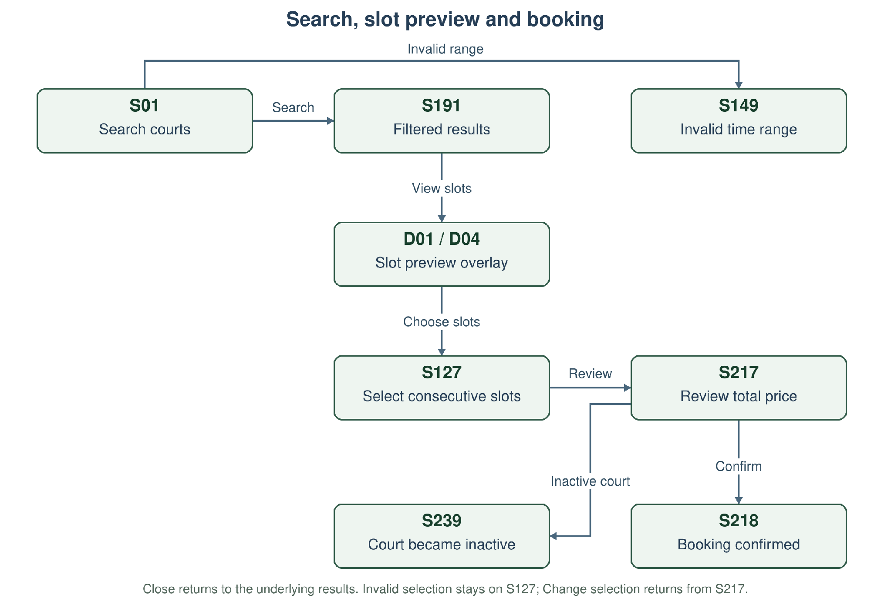

Figure 8-1. Selected screen relationships for the corresponding journey.

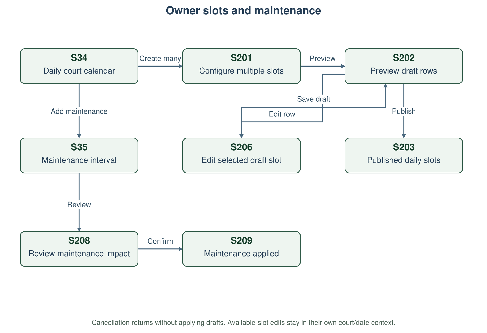

Figure 8-2. Selected screen relationships for the corresponding journey.

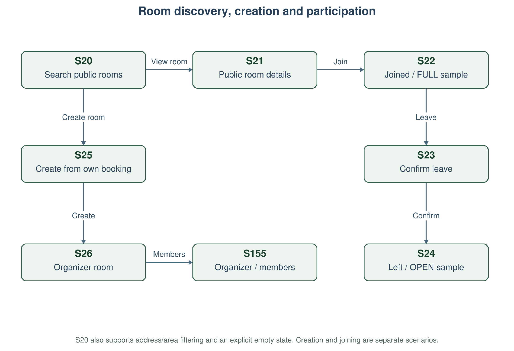

Figure 8-3. Selected screen relationships for the corresponding journey.

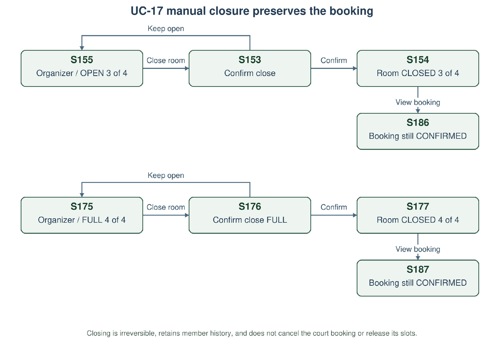

Figure 8-4. Selected screen relationships for the corresponding journey.

### 8.3. Representative Current Mockups

These figures replace the earlier search form without time limits and the former fixed Slot A/Slot B publication form. Long calendars and result lists use scrolling; a viewport illustration may show only the first part. All controls remain explained in Section 8.4 and full editable frames remain linked.

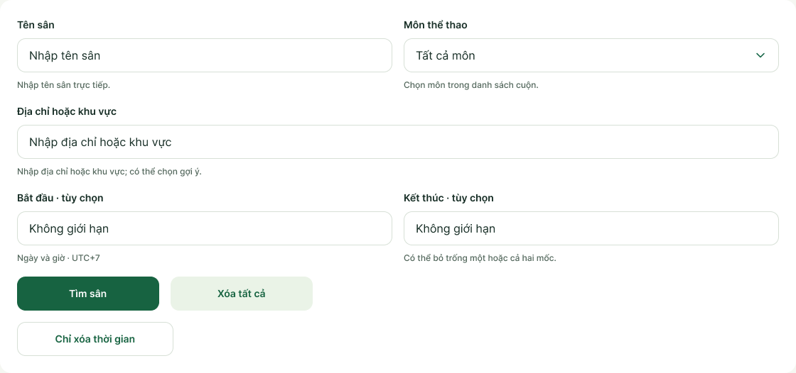

Figure 8-5. Current search controls: court name, scrollable sport dropdown, address/area and independent optional time bounds. The exported detail is the search-form region of S01.  [Open S01](https://www.figma.com/design/fR2n35EUsOIvoEWeIqcIbA/SE_FE_Design_CourtMate?node-id=27-2)

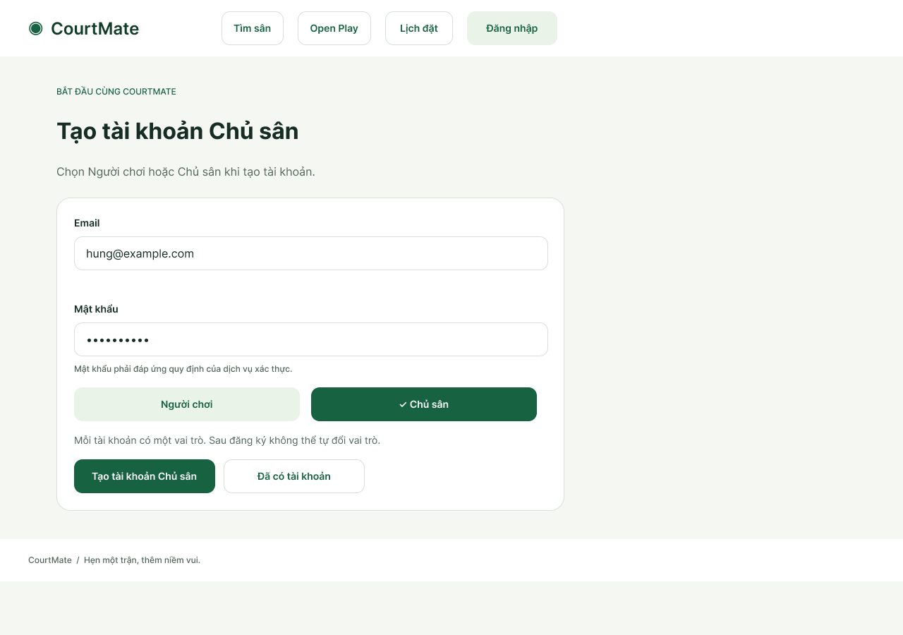

Figure 8-6. Court Owner registration is an initial role-selection branch of Register Account.  [Open S151](https://www.figma.com/design/fR2n35EUsOIvoEWeIqcIbA/SE_FE_Design_CourtMate?node-id=181-1638)

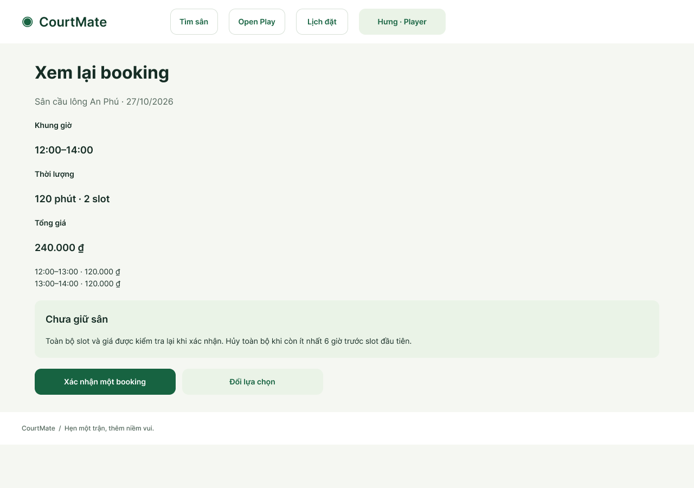

Figure 8-7. A representative review state for two adjacent 12:00–14:00 slots, 120 minutes and a 240,000 VND total.  [Open S217](https://www.figma.com/design/fR2n35EUsOIvoEWeIqcIbA/SE_FE_Design_CourtMate?node-id=221-3508)

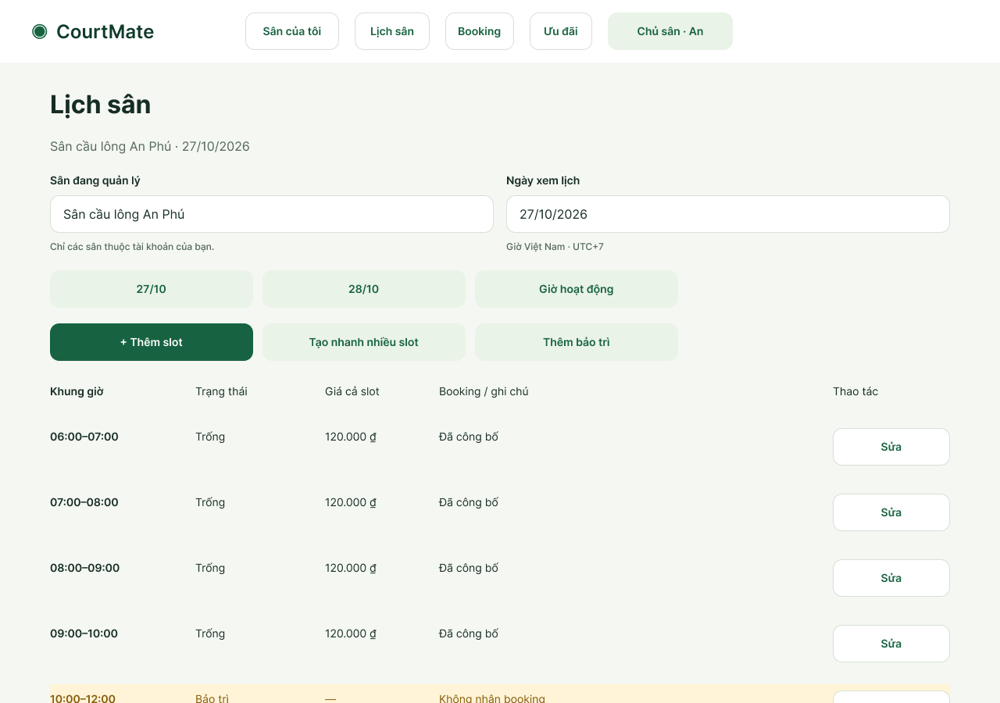

Figure 8-8. The daily Owner calendar replaces the fixed two-slot form; scroll for later AVAILABLE, BOOKED, BLOCKED and unpublished intervals.  [Open S34](https://www.figma.com/design/fR2n35EUsOIvoEWeIqcIbA/SE_FE_Design_CourtMate?node-id=44-1070)

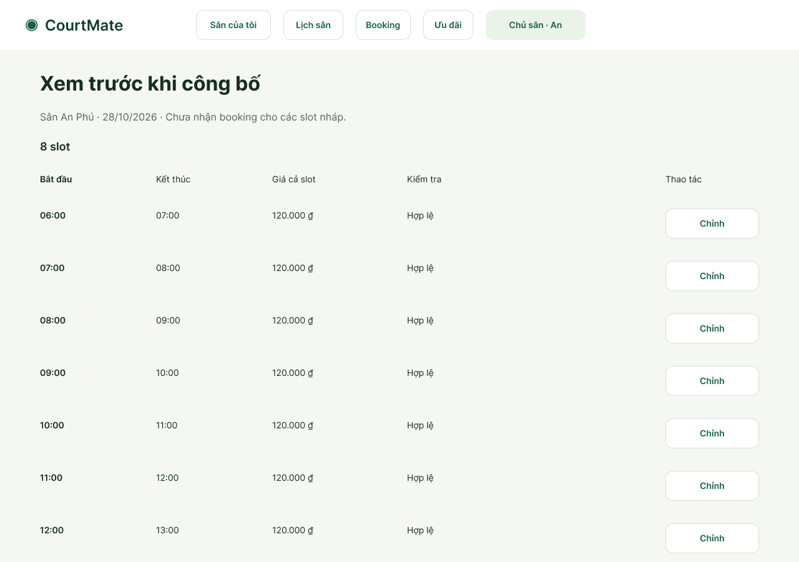

Figure 8-9. Draft-row preview for batch publication. The sample has eight rows with a ninth-row interaction; scroll to the publication action.  [Open S202](https://www.figma.com/design/fR2n35EUsOIvoEWeIqcIbA/SE_FE_Design_CourtMate?node-id=221-2554)

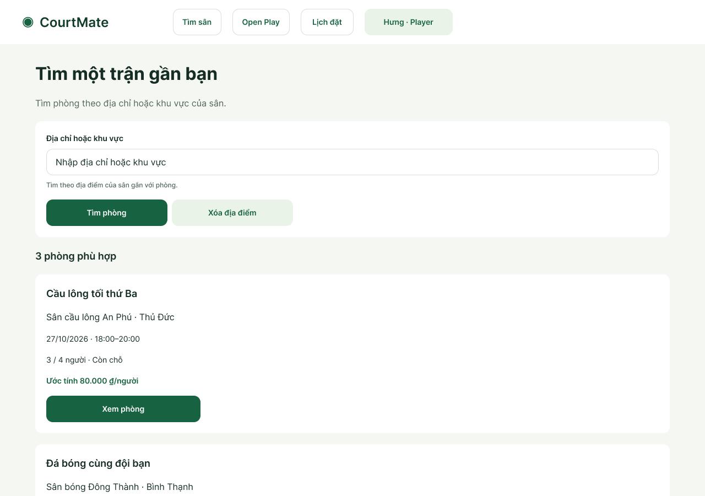

Figure 8-10. Open Play discovery now includes court address/area search and independent location clearing.  [Open S20](https://www.figma.com/design/fR2n35EUsOIvoEWeIqcIbA/SE_FE_Design_CourtMate?node-id=44-445)

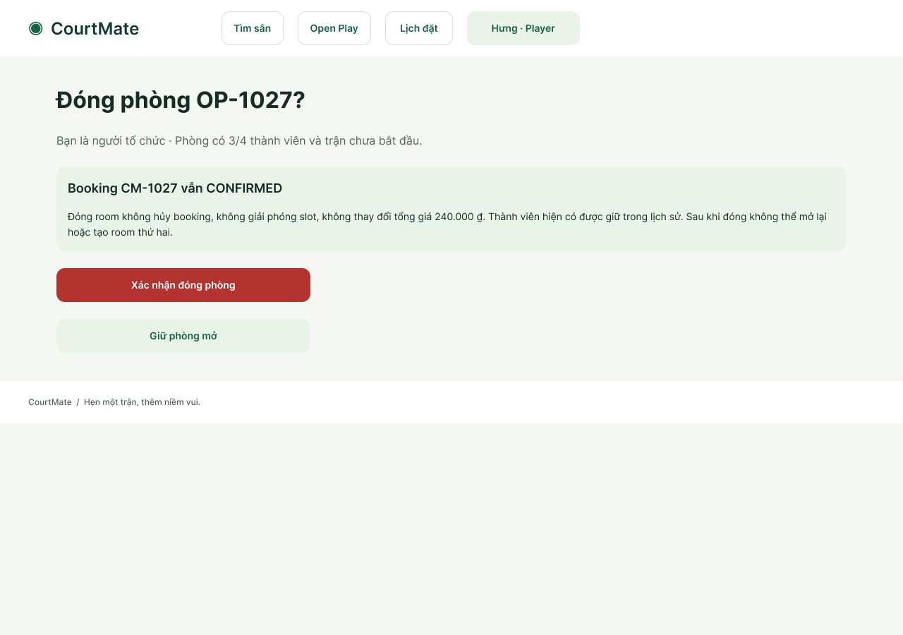

Figure 8-11. UC-17 closure confirmation explains participant history and the unchanged CONFIRMED court booking.  [Open S153](https://www.figma.com/design/fR2n35EUsOIvoEWeIqcIbA/SE_FE_Design_CourtMate?node-id=182-1935)

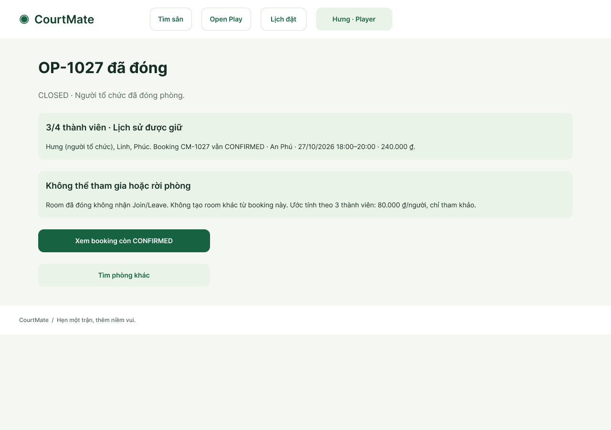

Figure 8-12. Manual CLOSED room result: membership history retained; further joins/leaves unavailable; the booking remains accessible.  [Open S154](https://www.figma.com/design/fR2n35EUsOIvoEWeIqcIbA/SE_FE_Design_CourtMate?node-id=182-1971)

### 8.4. Screen Specifications

The following specifications define required application behavior and feedback. The native Figma prototype uses predefined data, variable states and clickable navigation. It does not accept arbitrary keyboard input, call Firebase, persist bookings, execute server transactions, or prove keyboard/screen-reader compliance. Prefix matching and free-form text entry describe the intended application interaction; bounded sample states demonstrate the design.

S03 / S151 / S02 / S04 — Account forms

| Control / action | Required behavior and validation | Feedback / next state |
| --- | --- | --- |
| Email, password and role | Accept email/password according to the identity provider’s validation. Initial registration allows Player or Court Owner; show the selected role and prohibit later self-editing of that role. Registration failure creates no protected session. | Success uses [S05](https://www.figma.com/design/fR2n35EUsOIvoEWeIqcIbA/SE_FE_Design_CourtMate?node-id=27-284) or [S152](https://www.figma.com/design/fR2n35EUsOIvoEWeIqcIbA/SE_FE_Design_CourtMate?node-id=181-1682). Field errors remain on the form; no real credentials or identity-provider transaction are executed in the prototype. |
| Sign in, sign out, session recovery | Successful sign-in routes to the role-appropriate entry. Signing out removes protected access. Missing/expired identity or an invalid role cannot authorize a protected action. | Use [S17](https://www.figma.com/design/fR2n35EUsOIvoEWeIqcIbA/SE_FE_Design_CourtMate?node-id=44-365), [S18](https://www.figma.com/design/fR2n35EUsOIvoEWeIqcIbA/SE_FE_Design_CourtMate?node-id=44-393), [S19](https://www.figma.com/design/fR2n35EUsOIvoEWeIqcIbA/SE_FE_Design_CourtMate?node-id=44-419) or [S49](https://www.figma.com/design/fR2n35EUsOIvoEWeIqcIbA/SE_FE_Design_CourtMate?node-id=44-1640) as appropriate; retain only non-sensitive input during recovery. |

S01 / S191 / D01 / D04 — Search and slot preview

| Control / action | Required behavior and validation | Feedback / next state |
| --- | --- | --- |
| Court name and address/area | Allow direct court-name text and either a full address or a broader area. Address suggestions are optional shortcuts; manual filtering must work without GPS. Editing one criterion preserves all other selected criteria. | Search combines selected name, sport, location and time criteria. No matching court produces an explicit empty state rather than unrelated results. |
| Sport dropdown | Open a menu anchored below the sport field. Keep the search box above a bounded vertically scrollable option list; typing a name prefix narrows the options. Choosing an option updates the displayed sport; All sports removes only that restriction. | The design is a scrollable dropdown, not a separate centered input dialog or a permanently expanded checklist. Current native Figma uses sample states rather than arbitrary keyboard input. |
| Optional start/end datetime | Accept either bound independently or both, using displayed Vietnam time. With both supplied, the end must be later than the start. A displayed matching slot must lie within the applied bounds; clearing time preserves name, sport and location. | Invalid ranges show [S149](https://www.figma.com/design/fR2n35EUsOIvoEWeIqcIbA/SE_FE_Design_CourtMate?node-id=180-1663). No eligible court/slot shows an empty state. The implementation must validate datetime syntax and eligibility against server time. |
| Search, clear and result cards | Search applies the current criteria together and keeps them visible on the result screen. Clear all resets all criteria; Clear time resets only the two temporal bounds. Each active court card links to its court details and slot preview. | [S191](https://www.figma.com/design/fR2n35EUsOIvoEWeIqcIbA/SE_FE_Design_CourtMate?node-id=196-2104) is the desktop result state; [S192](https://www.figma.com/design/fR2n35EUsOIvoEWeIqcIbA/SE_FE_Design_CourtMate?node-id=196-2264)/[S193](https://www.figma.com/design/fR2n35EUsOIvoEWeIqcIbA/SE_FE_Design_CourtMate?node-id=196-2437)/[S194](https://www.figma.com/design/fR2n35EUsOIvoEWeIqcIbA/SE_FE_Design_CourtMate?node-id=196-2563) are guest/phone/tablet variants. Availability is not reserved by searching. |
| View slots overlay | Provide the slot-preview link even when no time filter is applied. With time limits, list eligible matching slots only; without time limits, show nearest upcoming eligible published slots in time order. Show playing date, interval, full-slot price and availability. | Close returns to the same underlying results. Loading, empty and failure are [D09](https://www.figma.com/design/fR2n35EUsOIvoEWeIqcIbA/SE_FE_Design_CourtMate?node-id=180-1750), [D08](https://www.figma.com/design/fR2n35EUsOIvoEWeIqcIbA/SE_FE_Design_CourtMate?node-id=180-1741) and [D10](https://www.figma.com/design/fR2n35EUsOIvoEWeIqcIbA/SE_FE_Design_CourtMate?node-id=180-1756); full-day selection is available through [S127](https://www.figma.com/design/fR2n35EUsOIvoEWeIqcIbA/SE_FE_Design_CourtMate?node-id=92-1199). No unpublished, booked or blocked slot is presented as selectable. |

S06 / S127 / S217 / S218 — Court details and booking

| Control / action | Required behavior and validation | Feedback / next state |
| --- | --- | --- |
| Court details and available slots | Show court name, sport, address/area, description, supplied photos, owner/contact fields approved for display, base price and a link to published availability. Explain that the quoted price of each slot is used for booking. | GPS denial must not block details or manual location/directions. Slot status must include text rather than color alone. |
| Slot selection and review | Select only future AVAILABLE published slots for one active court/date. Allow one or multiple strictly adjacent slots totalling 60–240 minutes. Display ordered slots, complete interval, each quote and their sum before confirmation. | Invalid or discontiguous selection stays on [S127](https://www.figma.com/design/fR2n35EUsOIvoEWeIqcIbA/SE_FE_Design_CourtMate?node-id=92-1199) with a reason. Clear selection is available. Review occurs at [S217](https://www.figma.com/design/fR2n35EUsOIvoEWeIqcIbA/SE_FE_Design_CourtMate?node-id=221-3508); changing the choice returns to [S127](https://www.figma.com/design/fR2n35EUsOIvoEWeIqcIbA/SE_FE_Design_CourtMate?node-id=92-1199). |
| Confirm one booking | Recheck the whole selection, permissions, schedule, conflicts, current quotes and applicable F09 offers. Commit exactly one complete booking or none. Mere selection/review reserves nothing. | [S218](https://www.figma.com/design/fR2n35EUsOIvoEWeIqcIbA/SE_FE_Design_CourtMate?node-id=221-3564) is the success fixture. [S10](https://www.figma.com/design/fR2n35EUsOIvoEWeIqcIbA/SE_FE_Design_CourtMate?node-id=27-534)/[S11](https://www.figma.com/design/fR2n35EUsOIvoEWeIqcIbA/SE_FE_Design_CourtMate?node-id=27-560)/[S137](https://www.figma.com/design/fR2n35EUsOIvoEWeIqcIbA/SE_FE_Design_CourtMate?node-id=96-1276)/[S138](https://www.figma.com/design/fR2n35EUsOIvoEWeIqcIbA/SE_FE_Design_CourtMate?node-id=96-1314) document conflict/repricing outcomes; [S239](https://www.figma.com/design/fR2n35EUsOIvoEWeIqcIbA/SE_FE_Design_CourtMate?node-id=232-3526) covers an inactive court. The native prototype does not perform transactional server validation. |

S12 / S13 / S14 — My bookings and cancellation

| Control / action | Required behavior and validation | Feedback / next state |
| --- | --- | --- |
| History and booking details | Show the ten most recent owned records (or all if fewer), newest booking timestamp first. A multi-slot booking is one record with its unique ID, court, overall interval, accepted total and status. | Only the owning Player may view/cancel protected records. A room-linked booking retains links to its room/history. |
| Cancel / Keep Booking | Confirm cancellation of the entire booking and explain any linked-room closure. Recheck ownership/status and at least six hours before the earliest slot start; Keep Booking returns without changes. | [S14](https://www.figma.com/design/fR2n35EUsOIvoEWeIqcIbA/SE_FE_Design_CourtMate?node-id=44-283) shows the CANCELLED result. [S15](https://www.figma.com/design/fR2n35EUsOIvoEWeIqcIbA/SE_FE_Design_CourtMate?node-id=44-313)/[S132](https://www.figma.com/design/fR2n35EUsOIvoEWeIqcIbA/SE_FE_Design_CourtMate?node-id=94-1262) reject ineligible cancellation, [S131](https://www.figma.com/design/fR2n35EUsOIvoEWeIqcIbA/SE_FE_Design_CourtMate?node-id=94-1236) shows the exact six-hour boundary. Release the whole reservation together; no partial-slot cancellation or payment/refund operation is offered. |

S30 / S31 / S32 / S33 — Owned court listings

| Control / action | Required behavior and validation | Feedback / next state |
| --- | --- | --- |
| Create/edit court | Capture name, sport, full address/area, description, positive base price and integer max_players from 2 to 30. Preserve input on validation failure; editing is restricted to an owned court. | Reject a decrease that would invalidate a future OPEN/FULL linked room’s capacity. [S41](https://www.figma.com/design/fR2n35EUsOIvoEWeIqcIbA/SE_FE_Design_CourtMate?node-id=44-1358)/[S129](https://www.figma.com/design/fR2n35EUsOIvoEWeIqcIbA/SE_FE_Design_CourtMate?node-id=93-1217) represent invalid input/capacity. Creating a court leads to its own setup at [S221](https://www.figma.com/design/fR2n35EUsOIvoEWeIqcIbA/SE_FE_Design_CourtMate?node-id=221-3748), not another court’s schedule. |
| Deactivate court | Request confirmation that new bookings stop while existing booking records, intervals, accepted totals and statuses remain intact. Keep active returns without change. | [S219](https://www.figma.com/design/fR2n35EUsOIvoEWeIqcIbA/SE_FE_Design_CourtMate?node-id=221-3620) is the inactive listing fixture. Existing bookings remain available through owner booking views. |

S34 / S201 / S202 / S203 / S206 — Calendar and slots

| Control / action | Required behavior and validation | Feedback / next state |
| --- | --- | --- |
| Court/date and daily calendar | Retain the selected owned court and playing date. Distinguish AVAILABLE, BOOKED, BLOCKED and not-yet-published time with text labels and contextual actions. Scroll through the entire operating day. | No fixed two-slot publication limit is imposed. BOOKED rows open their booking; unpublished time is not a selectable Player slot. |
| Create many / preview / publish | Enter dated start/end, each slot’s 60–240-minute duration and positive whole-VND full-slot price. Generate draft rows on the 30-minute grid, within opening hours, with no overlap or maintenance conflict. Review and correct individual rows before publication. | [S201](https://www.figma.com/design/fR2n35EUsOIvoEWeIqcIbA/SE_FE_Design_CourtMate?node-id=221-2490) → [S202](https://www.figma.com/design/fR2n35EUsOIvoEWeIqcIbA/SE_FE_Design_CourtMate?node-id=221-2554) → [S203](https://www.figma.com/design/fR2n35EUsOIvoEWeIqcIbA/SE_FE_Design_CourtMate?node-id=221-2618). The sample generates eight rows and can show a ninth; this is sample data, not a product cap. Back/Cancel must not publish drafts. |
| Add/edit one slot and operating hours | Add a dated slot or edit the chosen AVAILABLE slot in its own court/date context. Preserve other slots’ prices. An already CONFIRMED booking locks its constituent slots’ time intervals and regular quotes. | [S204](https://www.figma.com/design/fR2n35EUsOIvoEWeIqcIbA/SE_FE_Design_CourtMate?node-id=221-2682)/[S205](https://www.figma.com/design/fR2n35EUsOIvoEWeIqcIbA/SE_FE_Design_CourtMate?node-id=221-2746) add one slot; [S206](https://www.figma.com/design/fR2n35EUsOIvoEWeIqcIbA/SE_FE_Design_CourtMate?node-id=221-2810)/[S207](https://www.figma.com/design/fR2n35EUsOIvoEWeIqcIbA/SE_FE_Design_CourtMate?node-id=221-2874) edit; [S210](https://www.figma.com/design/fR2n35EUsOIvoEWeIqcIbA/SE_FE_Design_CourtMate?node-id=221-3066)/[S211](https://www.figma.com/design/fR2n35EUsOIvoEWeIqcIbA/SE_FE_Design_CourtMate?node-id=221-3130) set hours. Reject any change invalidating an existing confirmed booking; [S157](https://www.figma.com/design/fR2n35EUsOIvoEWeIqcIbA/SE_FE_Design_CourtMate?node-id=182-2110)/[S158](https://www.figma.com/design/fR2n35EUsOIvoEWeIqcIbA/SE_FE_Design_CourtMate?node-id=182-2151) demonstrate the lock. |

S35 / S208 / S209 — Maintenance

| Control / action | Required behavior and validation | Feedback / next state |
| --- | --- | --- |
| Interval and impact confirmation | Enter the owned court/date and maintenance interval, then preview the affected AVAILABLE time before confirming. Reject overlap with any confirmed booking, including a combined booking. | [S35](https://www.figma.com/design/fR2n35EUsOIvoEWeIqcIbA/SE_FE_Design_CourtMate?node-id=44-1123) → [S208](https://www.figma.com/design/fR2n35EUsOIvoEWeIqcIbA/SE_FE_Design_CourtMate?node-id=221-2938) → [S209](https://www.figma.com/design/fR2n35EUsOIvoEWeIqcIbA/SE_FE_Design_CourtMate?node-id=221-3002) is the valid sample. [S36](https://www.figma.com/design/fR2n35EUsOIvoEWeIqcIbA/SE_FE_Design_CourtMate?node-id=44-1174) is the rejection fixture. Cancel preserves the valid schedule and all existing bookings. |

S38 / S39 — Owner booking views

| Control / action | Required behavior and validation | Feedback / next state |
| --- | --- | --- |
| Filters, list and details | Limit data to owned courts; support booking/status/date lookup. Details identify the booking, court, full interval, status, creation timestamp and Player registration email and display name when present. | Show empty/error states appropriately. [S40](https://www.figma.com/design/fR2n35EUsOIvoEWeIqcIbA/SE_FE_Design_CourtMate?node-id=44-1331) demonstrates rejected access to another Owner’s data; no force-cancellation control is introduced. |

S20 / S21 — Public room discovery

| Control / action | Required behavior and validation | Feedback / next state |
| --- | --- | --- |
| Address/area search and room list | Accept a full court address or an area, with optional suggestions. Apply the criterion to the linked court and show matching rooms with full playing interval, current count/capacity, effective status and per-person estimate. | Clear location restores the public list. [S212](https://www.figma.com/design/fR2n35EUsOIvoEWeIqcIbA/SE_FE_Design_CourtMate?node-id=221-3194) is the empty-location result; [S94](https://www.figma.com/design/fR2n35EUsOIvoEWeIqcIbA/SE_FE_Design_CourtMate?node-id=44-3445) is public guest discovery. Retain the criterion when returning from details. |
| View room | Display public organizer/court/interval, capacity, membership, status and informational estimate. Searching or viewing changes no membership or booking. | An unauthenticated Visitor may browse but must sign in for protected participation. Effective CLOSED rooms prohibit join/leave. |

S25 / S26 — Create room

| Control / action | Required behavior and validation | Feedback / next state |
| --- | --- | --- |
| Owned booking and capacity | Choose only an owned future CONFIRMED booking not already linked to a room. Inherit its court and complete interval. Accept integer capacity C between 2 and twice court.max_players; count the organizer as member one. | Revalidate before creation. [S27](https://www.figma.com/design/fR2n35EUsOIvoEWeIqcIbA/SE_FE_Design_CourtMate?node-id=44-773)/[S29](https://www.figma.com/design/fR2n35EUsOIvoEWeIqcIbA/SE_FE_Design_CourtMate?node-id=44-831) handle invalid capacity or an existing room; [S145](https://www.figma.com/design/fR2n35EUsOIvoEWeIqcIbA/SE_FE_Design_CourtMate?node-id=110-1358)/[S146](https://www.figma.com/design/fR2n35EUsOIvoEWeIqcIbA/SE_FE_Design_CourtMate?node-id=110-1407) demonstrate max_players=8 with capacity 16. |
| Create / Cancel | Create at most one public room per eligible booking, then show the room and its informational cost estimate. Cancel returns without room creation. | The estimate is the saved accepted booking total divided by current enrolled members, including organizer, rounded to whole VND; it is not a payment request. |

S21 / S22 / S23 / S24 — Join and leave

| Control / action | Required behavior and validation | Feedback / next state |
| --- | --- | --- |
| Join room | Require an authenticated eligible Player, OPEN status, a future CONFIRMED linked booking, a free place and no existing active membership. Recheck eligibility on submission. | [S22](https://www.figma.com/design/fR2n35EUsOIvoEWeIqcIbA/SE_FE_Design_CourtMate?node-id=44-555) is a joined/FULL fixture; [S63](https://www.figma.com/design/fR2n35EUsOIvoEWeIqcIbA/SE_FE_Design_CourtMate?node-id=44-1851)/[S78](https://www.figma.com/design/fR2n35EUsOIvoEWeIqcIbA/SE_FE_Design_CourtMate?node-id=44-2973) reject a lost final place or a full room. Concurrent duplicate/overcapacity prevention requires backend testing. |
| Leave / Stay | Before earliest start, permit an enrolled non-organizer to leave an OPEN/FULL room; update count and estimate and reopen FULL when a place becomes free. Stay preserves membership. | [S23](https://www.figma.com/design/fR2n35EUsOIvoEWeIqcIbA/SE_FE_Design_CourtMate?node-id=44-603) → [S24](https://www.figma.com/design/fR2n35EUsOIvoEWeIqcIbA/SE_FE_Design_CourtMate?node-id=44-631) is the leave sample. The organizer cannot abandon the source-booking relationship through Leave. Started/CLOSED rooms reject participation changes. |

S155 / S153 / S154 — UC-17 close own room

| Control / action | Required behavior and validation | Feedback / next state |
| --- | --- | --- |
| Close Room / Keep Open | Offer manual closure only to the room’s authenticated organizer. Confirm irreversibility, blocked future joins/leaves, retained member history and the fact that the court booking is not cancelled. Permit closure even when others have joined or the room is FULL. | Keep Open returns to [S155](https://www.figma.com/design/fR2n35EUsOIvoEWeIqcIbA/SE_FE_Design_CourtMate?node-id=182-2012) (or [S175](https://www.figma.com/design/fR2n35EUsOIvoEWeIqcIbA/SE_FE_Design_CourtMate?node-id=185-2059) for FULL). Recheck organizer ownership, booking/time and current status before changing the room. |
| Closed result and booking link | Show CLOSED with the manual-closure reason, retained member count/history and disabled participation. Keep the booking CONFIRMED with unchanged slots and accepted total. Do not reopen or create a second room for the same source booking. | [S154](https://www.figma.com/design/fR2n35EUsOIvoEWeIqcIbA/SE_FE_Design_CourtMate?node-id=182-1971) → [S186](https://www.figma.com/design/fR2n35EUsOIvoEWeIqcIbA/SE_FE_Design_CourtMate?node-id=190-1965) verifies the unchanged booking fixture; [S175](https://www.figma.com/design/fR2n35EUsOIvoEWeIqcIbA/SE_FE_Design_CourtMate?node-id=185-2059)/[S176](https://www.figma.com/design/fR2n35EUsOIvoEWeIqcIbA/SE_FE_Design_CourtMate?node-id=186-2263)/[S177](https://www.figma.com/design/fR2n35EUsOIvoEWeIqcIbA/SE_FE_Design_CourtMate?node-id=186-2289)/[S187](https://www.figma.com/design/fR2n35EUsOIvoEWeIqcIbA/SE_FE_Design_CourtMate?node-id=190-2014) cover FULL. An already CLOSED room displays current state; unauthorized/failed requests cannot claim closure. |

S46 / S47 / S48 — Basic profile (Should)

| Control / action | Required behavior and validation | Feedback / next state |
| --- | --- | --- |
| Editable profile fields | Allow permitted basic profile/contact-preference changes only. Do not expose role or identity-provider-controlled fields as editable profile settings. | Validate before save, retain input on failure and preserve protected fields. [S47](https://www.figma.com/design/fR2n35EUsOIvoEWeIqcIbA/SE_FE_Design_CourtMate?node-id=44-1584)/[S48](https://www.figma.com/design/fR2n35EUsOIvoEWeIqcIbA/SE_FE_Design_CourtMate?node-id=44-1609) demonstrate success/error; [S76](https://www.figma.com/design/fR2n35EUsOIvoEWeIqcIbA/SE_FE_Design_CourtMate?node-id=44-2892) is the Owner variant. |

S42 / S43 / S220 — Slot-specific offers (Should)

| Control / action | Required behavior and validation | Feedback / next state |
| --- | --- | --- |
| Create offer | Require an owned AVAILABLE unblocked slot strictly in the future and within 24 hours, no other ACTIVE offer, and a positive whole-VND price below the regular slot quote. Apply the offer to that slot only. | [S44](https://www.figma.com/design/fR2n35EUsOIvoEWeIqcIbA/SE_FE_Design_CourtMate?node-id=44-1484)/[S159](https://www.figma.com/design/fR2n35EUsOIvoEWeIqcIbA/SE_FE_Design_CourtMate?node-id=182-2189) are invalid/duplicate fixtures. [S43](https://www.figma.com/design/fR2n35EUsOIvoEWeIqcIbA/SE_FE_Design_CourtMate?node-id=44-1433) is eligible creation. Optional discounted booking confirmation is UC-05, not an Owner action. |
| Deactivate offer | Confirm deactivation of the selected ACTIVE offer. Preserve accepted totals of prior bookings. A deactivated offer does not revive automatically; a new offer is permitted only while the slot is still eligible. | [S220](https://www.figma.com/design/fR2n35EUsOIvoEWeIqcIbA/SE_FE_Design_CourtMate?node-id=221-3684) returns to [S42](https://www.figma.com/design/fR2n35EUsOIvoEWeIqcIbA/SE_FE_Design_CourtMate?node-id=44-1393). UC-07 governs conditional offer reappearance after cancellation; UC-05 governs quote revalidation and accepted-price storage. |

### 8.5. Prototype Scenarios and Verification

On 30 October 2026, existing frame IDs, stored reactions and selected conditional actions were inspected. The checks below evaluated stored prototype actions in memory and inspected design-state content; they did not run an implemented website, identity service or database. No missing destination was found in the 16 checked screen roots. Source code/test-case identifiers will be added in the later phases when they exist.

| Journey | Screen sequence | Expected outcome | Observed evidence / limitation |
| --- | --- | --- | --- |
| Registration and role access | [S03](https://www.figma.com/design/fR2n35EUsOIvoEWeIqcIbA/SE_FE_Design_CourtMate?node-id=27-242) → [S05](https://www.figma.com/design/fR2n35EUsOIvoEWeIqcIbA/SE_FE_Design_CourtMate?node-id=27-284); [S151](https://www.figma.com/design/fR2n35EUsOIvoEWeIqcIbA/SE_FE_Design_CourtMate?node-id=181-1638) → [S152](https://www.figma.com/design/fR2n35EUsOIvoEWeIqcIbA/SE_FE_Design_CourtMate?node-id=181-1682); [S02](https://www.figma.com/design/fR2n35EUsOIvoEWeIqcIbA/SE_FE_Design_CourtMate?node-id=27-134)/[S04](https://www.figma.com/design/fR2n35EUsOIvoEWeIqcIbA/SE_FE_Design_CourtMate?node-id=27-188) | Initial role selection succeeds into the correct account context; later role escalation is denied. | Screen text/routes inspected; IdP and authorization execution pending. |
| Court search and preview | [S01](https://www.figma.com/design/fR2n35EUsOIvoEWeIqcIbA/SE_FE_Design_CourtMate?node-id=27-2) → [S191](https://www.figma.com/design/fR2n35EUsOIvoEWeIqcIbA/SE_FE_Design_CourtMate?node-id=196-2104) → [D01](https://www.figma.com/design/fR2n35EUsOIvoEWeIqcIbA/SE_FE_Design_CourtMate?node-id=180-1409)/[D04](https://www.figma.com/design/fR2n35EUsOIvoEWeIqcIbA/SE_FE_Design_CourtMate?node-id=180-1499); [S149](https://www.figma.com/design/fR2n35EUsOIvoEWeIqcIbA/SE_FE_Design_CourtMate?node-id=180-1663) for invalid range | Retain unrelated filters, show only matching eligible slots, and keep preview access with or without time bounds. | Stored-action cases checked for sport preservation and 12:00–14:00 matching. |
| One or several consecutive slots | [S127](https://www.figma.com/design/fR2n35EUsOIvoEWeIqcIbA/SE_FE_Design_CourtMate?node-id=92-1199) → [S217](https://www.figma.com/design/fR2n35EUsOIvoEWeIqcIbA/SE_FE_Design_CourtMate?node-id=221-3508) → [S218](https://www.figma.com/design/fR2n35EUsOIvoEWeIqcIbA/SE_FE_Design_CourtMate?node-id=221-3564); return [S217](https://www.figma.com/design/fR2n35EUsOIvoEWeIqcIbA/SE_FE_Design_CourtMate?node-id=221-3508) → [S127](https://www.figma.com/design/fR2n35EUsOIvoEWeIqcIbA/SE_FE_Design_CourtMate?node-id=92-1199) | Exactly one complete booking at the accepted sum; invalid/discontiguous or over-240-minute selections cannot proceed. | All 512 combinations of the nine sample AVAILABLE slots checked: 21 valid; no mismatch. No database confirmation was executed. |
| Whole-booking cancellation | [S12](https://www.figma.com/design/fR2n35EUsOIvoEWeIqcIbA/SE_FE_Design_CourtMate?node-id=44-122) → [S13](https://www.figma.com/design/fR2n35EUsOIvoEWeIqcIbA/SE_FE_Design_CourtMate?node-id=44-241) → [S14](https://www.figma.com/design/fR2n35EUsOIvoEWeIqcIbA/SE_FE_Design_CourtMate?node-id=44-283); [S131](https://www.figma.com/design/fR2n35EUsOIvoEWeIqcIbA/SE_FE_Design_CourtMate?node-id=94-1236)/[S132](https://www.figma.com/design/fR2n35EUsOIvoEWeIqcIbA/SE_FE_Design_CourtMate?node-id=94-1262) boundaries | Keep leaves all records intact; an eligible cancellation releases the complete reservation and closes any linked room. | Confirmation/rejection fixtures inspected. Server-time and atomic-write tests pending. |
| Owner publication and changes | [S34](https://www.figma.com/design/fR2n35EUsOIvoEWeIqcIbA/SE_FE_Design_CourtMate?node-id=44-1070) → [S201](https://www.figma.com/design/fR2n35EUsOIvoEWeIqcIbA/SE_FE_Design_CourtMate?node-id=221-2490) → [S202](https://www.figma.com/design/fR2n35EUsOIvoEWeIqcIbA/SE_FE_Design_CourtMate?node-id=221-2554) → [S203](https://www.figma.com/design/fR2n35EUsOIvoEWeIqcIbA/SE_FE_Design_CourtMate?node-id=221-2618); [S202](https://www.figma.com/design/fR2n35EUsOIvoEWeIqcIbA/SE_FE_Design_CourtMate?node-id=221-2554) → [S206](https://www.figma.com/design/fR2n35EUsOIvoEWeIqcIbA/SE_FE_Design_CourtMate?node-id=221-2810) → [S202](https://www.figma.com/design/fR2n35EUsOIvoEWeIqcIbA/SE_FE_Design_CourtMate?node-id=221-2554) | Review many draft rows, update the selected date/slot only, and publish after explicit confirmation. | Ninth-row state and all 26 sample date/slot edit targets checked; no mismatch. |
| Maintenance and protected bookings | [S34](https://www.figma.com/design/fR2n35EUsOIvoEWeIqcIbA/SE_FE_Design_CourtMate?node-id=44-1070) → [S35](https://www.figma.com/design/fR2n35EUsOIvoEWeIqcIbA/SE_FE_Design_CourtMate?node-id=44-1123) → [S208](https://www.figma.com/design/fR2n35EUsOIvoEWeIqcIbA/SE_FE_Design_CourtMate?node-id=221-2938) → [S209](https://www.figma.com/design/fR2n35EUsOIvoEWeIqcIbA/SE_FE_Design_CourtMate?node-id=221-3002); [S36](https://www.figma.com/design/fR2n35EUsOIvoEWeIqcIbA/SE_FE_Design_CourtMate?node-id=44-1174)/[S157](https://www.figma.com/design/fR2n35EUsOIvoEWeIqcIbA/SE_FE_Design_CourtMate?node-id=182-2110)/[S158](https://www.figma.com/design/fR2n35EUsOIvoEWeIqcIbA/SE_FE_Design_CourtMate?node-id=182-2151) | Preview effects and reject changes that would invalidate confirmed bookings. | Linked design states inspected; server enforcement pending. |
| Room discovery / participation | [S20](https://www.figma.com/design/fR2n35EUsOIvoEWeIqcIbA/SE_FE_Design_CourtMate?node-id=44-445) → [S21](https://www.figma.com/design/fR2n35EUsOIvoEWeIqcIbA/SE_FE_Design_CourtMate?node-id=44-499) → [S22](https://www.figma.com/design/fR2n35EUsOIvoEWeIqcIbA/SE_FE_Design_CourtMate?node-id=44-555) → [S23](https://www.figma.com/design/fR2n35EUsOIvoEWeIqcIbA/SE_FE_Design_CourtMate?node-id=44-603) → [S24](https://www.figma.com/design/fR2n35EUsOIvoEWeIqcIbA/SE_FE_Design_CourtMate?node-id=44-631); [S20](https://www.figma.com/design/fR2n35EUsOIvoEWeIqcIbA/SE_FE_Design_CourtMate?node-id=44-445) → [S25](https://www.figma.com/design/fR2n35EUsOIvoEWeIqcIbA/SE_FE_Design_CourtMate?node-id=44-679) → [S26](https://www.figma.com/design/fR2n35EUsOIvoEWeIqcIbA/SE_FE_Design_CourtMate?node-id=44-728) | Address/area filtering, truthful empty results, correct member count/status and informational cost after joins/leaves. | Full-address match and empty-result actions checked; join/leave links inspected. Concurrent membership tests pending. |
| Manual closure — UC-17 | [S155](https://www.figma.com/design/fR2n35EUsOIvoEWeIqcIbA/SE_FE_Design_CourtMate?node-id=182-2012) → [S153](https://www.figma.com/design/fR2n35EUsOIvoEWeIqcIbA/SE_FE_Design_CourtMate?node-id=182-1935) → [S154](https://www.figma.com/design/fR2n35EUsOIvoEWeIqcIbA/SE_FE_Design_CourtMate?node-id=182-1971) → [S186](https://www.figma.com/design/fR2n35EUsOIvoEWeIqcIbA/SE_FE_Design_CourtMate?node-id=190-1965); [S175](https://www.figma.com/design/fR2n35EUsOIvoEWeIqcIbA/SE_FE_Design_CourtMate?node-id=185-2059) → [S176](https://www.figma.com/design/fR2n35EUsOIvoEWeIqcIbA/SE_FE_Design_CourtMate?node-id=186-2263) → [S177](https://www.figma.com/design/fR2n35EUsOIvoEWeIqcIbA/SE_FE_Design_CourtMate?node-id=186-2289) → [S187](https://www.figma.com/design/fR2n35EUsOIvoEWeIqcIbA/SE_FE_Design_CourtMate?node-id=190-2014) | Keep Open returns unchanged; closure freezes participation while preserving the booking and member history, including FULL rooms. | Close/Keep/booking links checked. Static postconditions are shown; concurrent closure/join backend checks pending. |
| Owner slot offers (Should) | [S42](https://www.figma.com/design/fR2n35EUsOIvoEWeIqcIbA/SE_FE_Design_CourtMate?node-id=44-1393) → [S43](https://www.figma.com/design/fR2n35EUsOIvoEWeIqcIbA/SE_FE_Design_CourtMate?node-id=44-1433) → [S42](https://www.figma.com/design/fR2n35EUsOIvoEWeIqcIbA/SE_FE_Design_CourtMate?node-id=44-1393); [S42](https://www.figma.com/design/fR2n35EUsOIvoEWeIqcIbA/SE_FE_Design_CourtMate?node-id=44-1393) → [S220](https://www.figma.com/design/fR2n35EUsOIvoEWeIqcIbA/SE_FE_Design_CourtMate?node-id=221-3684) → [S42](https://www.figma.com/design/fR2n35EUsOIvoEWeIqcIbA/SE_FE_Design_CourtMate?node-id=44-1393) | Create/deactivate only the selected eligible slot offer, preserving other offers and saved booking totals. | Stored deactivation case checked; expiry/price/ownership enforcement pending. |

### 8.6. Accessibility and Usability Review

The review follows the instructor’s familiarity, consistency, minimal-surprise, recoverability, guidance and user-diversity principles. States use explicit labels and explanations, not color alone. The fixed two-slot publication form and centered filter-input dialogs have been replaced by the calendar/batch workflow and direct/anchored filter controls.

| Criterion | Current design evidence | Required verification / status |
| --- | --- | --- |
| Labels, state and recovery | Named fields; textual AVAILABLE/BOOKED/BLOCKED/CLOSED states; Keep/Cancel, clear filters, retry and empty-state actions. | Design review recorded. User task evaluation and implementation error-recovery checks remain pending. |
| Contrast tokens | Measured token pairs: ink on white 14.62:1; muted on white 6.16:1; white on green 7.25:1; green on soft 6.38:1; amber on amberSoft 5.48:1. | These sampled pairs exceed 4.5:1. This is token-level evidence only; all rendered text/control combinations still require checking. |
| Phone and tablet tasks | Linked 375/768/1280 design variants cover search, Player slots, Owner slots and room discovery; long lists/calendar views have bounded scrolling. | Verify the complete same task on actual phone/tablet/desktop browser viewports; independent frame existence is not a complete responsive test. |
| Keyboard and dialogs | The design specifies visible labels and bounded dropdown/overlay interactions. | Pending: Tab order, visible focus, Enter/Space, Escape, modal focus containment/return and scroll operation in the implemented browser UI. |
| Assistive technology | Court/slot/room states and errors are expressed in text. | Pending: semantic labels, accessible names, live error/status announcements, alt text and screen-reader operation. |
| Learnability and speed | Main tasks have explicit review/confirmation and contextual actions; Owner batch publication reduces repeated slot entry. | Pending: representative Player/Owner task sessions measuring completion, errors, recovery and feedback. Do not claim a successful user study. |
| Automated accessibility / NFR-05 | NFR-05 in Section 5.2 defines viewport, keyboard/label/state, text-contrast and Lighthouse targets. No Lighthouse or axe implementation result is claimed. | Run documented browser, keyboard, screen-reader, rendered-contrast and user/manual checks against the implementation. A Lighthouse score alone does not establish accessibility conformance. |

## 9. Requirements Traceability Matrix

### 9.1. Functional Requirement Traceability

Section 5.1 defines 46 FR IDs, including FR-046 for the search-result slot preview. The tables link the functional requirements, non-functional requirements and business rules to their use cases and prototype evidence. A screen link establishes design traceability, not implementation compliance; PA3 design and PA4 test-case identifiers remain planned until those artifacts exist.

| Req. ID | Use case(s) | Prototype / design-state evidence | Design element (PA3) | Test cases (PA4) |
| --- | --- | --- | --- | --- |
| FR-001 | UC-01 | [S03](https://www.figma.com/design/fR2n35EUsOIvoEWeIqcIbA/SE_FE_Design_CourtMate?node-id=27-242), [S151](https://www.figma.com/design/fR2n35EUsOIvoEWeIqcIbA/SE_FE_Design_CourtMate?node-id=181-1638), [S05](https://www.figma.com/design/fR2n35EUsOIvoEWeIqcIbA/SE_FE_Design_CourtMate?node-id=27-284), [S152](https://www.figma.com/design/fR2n35EUsOIvoEWeIqcIbA/SE_FE_Design_CourtMate?node-id=181-1682) | Planned in PA3 | Planned in PA4 |
| FR-002 | UC-02 | [S02](https://www.figma.com/design/fR2n35EUsOIvoEWeIqcIbA/SE_FE_Design_CourtMate?node-id=27-134), [S04](https://www.figma.com/design/fR2n35EUsOIvoEWeIqcIbA/SE_FE_Design_CourtMate?node-id=27-188), [S17](https://www.figma.com/design/fR2n35EUsOIvoEWeIqcIbA/SE_FE_Design_CourtMate?node-id=44-365), [S49](https://www.figma.com/design/fR2n35EUsOIvoEWeIqcIbA/SE_FE_Design_CourtMate?node-id=44-1640) | Planned in PA3 | Planned in PA4 |
| FR-003 | UC-01 / UC-02 | [S03](https://www.figma.com/design/fR2n35EUsOIvoEWeIqcIbA/SE_FE_Design_CourtMate?node-id=27-242), [S151](https://www.figma.com/design/fR2n35EUsOIvoEWeIqcIbA/SE_FE_Design_CourtMate?node-id=181-1638), [S77](https://www.figma.com/design/fR2n35EUsOIvoEWeIqcIbA/SE_FE_Design_CourtMate?node-id=44-2935), [S19](https://www.figma.com/design/fR2n35EUsOIvoEWeIqcIbA/SE_FE_Design_CourtMate?node-id=44-419) | Planned in PA3 | Planned in PA4 |
| FR-004 | UC-02, UC-05–10, UC-12–17 (UC-15/16 conditional) | [S17](https://www.figma.com/design/fR2n35EUsOIvoEWeIqcIbA/SE_FE_Design_CourtMate?node-id=44-365), [S18](https://www.figma.com/design/fR2n35EUsOIvoEWeIqcIbA/SE_FE_Design_CourtMate?node-id=44-393), [S19](https://www.figma.com/design/fR2n35EUsOIvoEWeIqcIbA/SE_FE_Design_CourtMate?node-id=44-419), [S49](https://www.figma.com/design/fR2n35EUsOIvoEWeIqcIbA/SE_FE_Design_CourtMate?node-id=44-1640); protected journeys in Section 8.4 | Planned in PA3 | Planned in PA4 |
| FR-005 | UC-05–10, UC-12–17 (UC-15/16 conditional) | [S18](https://www.figma.com/design/fR2n35EUsOIvoEWeIqcIbA/SE_FE_Design_CourtMate?node-id=44-393), [S40](https://www.figma.com/design/fR2n35EUsOIvoEWeIqcIbA/SE_FE_Design_CourtMate?node-id=44-1331), [S129](https://www.figma.com/design/fR2n35EUsOIvoEWeIqcIbA/SE_FE_Design_CourtMate?node-id=93-1217), [S153](https://www.figma.com/design/fR2n35EUsOIvoEWeIqcIbA/SE_FE_Design_CourtMate?node-id=182-1935); protected ownership checks in Section 8.4 | Planned in PA3 | Planned in PA4 |
| FR-006 | UC-03 | [S01](https://www.figma.com/design/fR2n35EUsOIvoEWeIqcIbA/SE_FE_Design_CourtMate?node-id=27-2), [S191](https://www.figma.com/design/fR2n35EUsOIvoEWeIqcIbA/SE_FE_Design_CourtMate?node-id=196-2104), [S50](https://www.figma.com/design/fR2n35EUsOIvoEWeIqcIbA/SE_FE_Design_CourtMate?node-id=44-1668), [S219](https://www.figma.com/design/fR2n35EUsOIvoEWeIqcIbA/SE_FE_Design_CourtMate?node-id=221-3620) | Planned in PA3 | Planned in PA4 |
| FR-007 | UC-03 | [S01](https://www.figma.com/design/fR2n35EUsOIvoEWeIqcIbA/SE_FE_Design_CourtMate?node-id=27-2), [S191](https://www.figma.com/design/fR2n35EUsOIvoEWeIqcIbA/SE_FE_Design_CourtMate?node-id=196-2104), [S197](https://www.figma.com/design/fR2n35EUsOIvoEWeIqcIbA/SE_FE_Design_CourtMate?node-id=212-3183) | Planned in PA3 | Planned in PA4 |
| FR-008 | UC-03 | [S01](https://www.figma.com/design/fR2n35EUsOIvoEWeIqcIbA/SE_FE_Design_CourtMate?node-id=27-2), [S191](https://www.figma.com/design/fR2n35EUsOIvoEWeIqcIbA/SE_FE_Design_CourtMate?node-id=196-2104), [S149](https://www.figma.com/design/fR2n35EUsOIvoEWeIqcIbA/SE_FE_Design_CourtMate?node-id=180-1663), [S150](https://www.figma.com/design/fR2n35EUsOIvoEWeIqcIbA/SE_FE_Design_CourtMate?node-id=180-1704), [S162](https://www.figma.com/design/fR2n35EUsOIvoEWeIqcIbA/SE_FE_Design_CourtMate?node-id=183-1660), [S163](https://www.figma.com/design/fR2n35EUsOIvoEWeIqcIbA/SE_FE_Design_CourtMate?node-id=183-1698), [D01](https://www.figma.com/design/fR2n35EUsOIvoEWeIqcIbA/SE_FE_Design_CourtMate?node-id=180-1409), [D04](https://www.figma.com/design/fR2n35EUsOIvoEWeIqcIbA/SE_FE_Design_CourtMate?node-id=180-1499) | Planned in PA3 | Planned in PA4 |
| FR-009 | UC-03 | [S50](https://www.figma.com/design/fR2n35EUsOIvoEWeIqcIbA/SE_FE_Design_CourtMate?node-id=44-1668), [S150](https://www.figma.com/design/fR2n35EUsOIvoEWeIqcIbA/SE_FE_Design_CourtMate?node-id=180-1704) | Planned in PA3 | Planned in PA4 |
| FR-010 | UC-04 | [S06](https://www.figma.com/design/fR2n35EUsOIvoEWeIqcIbA/SE_FE_Design_CourtMate?node-id=27-310), [S84](https://www.figma.com/design/fR2n35EUsOIvoEWeIqcIbA/SE_FE_Design_CourtMate?node-id=44-3067), [S85](https://www.figma.com/design/fR2n35EUsOIvoEWeIqcIbA/SE_FE_Design_CourtMate?node-id=44-3220), [S92](https://www.figma.com/design/fR2n35EUsOIvoEWeIqcIbA/SE_FE_Design_CourtMate?node-id=44-3373) | Planned in PA3 | Planned in PA4 |
| FR-011 | UC-03 / UC-04 | [D01](https://www.figma.com/design/fR2n35EUsOIvoEWeIqcIbA/SE_FE_Design_CourtMate?node-id=180-1409), [D04](https://www.figma.com/design/fR2n35EUsOIvoEWeIqcIbA/SE_FE_Design_CourtMate?node-id=180-1499), [S127](https://www.figma.com/design/fR2n35EUsOIvoEWeIqcIbA/SE_FE_Design_CourtMate?node-id=92-1199), [S93](https://www.figma.com/design/fR2n35EUsOIvoEWeIqcIbA/SE_FE_Design_CourtMate?node-id=44-3417) | Planned in PA3 | Planned in PA4 |
| FR-012 | UC-04 / UC-05 | [S127](https://www.figma.com/design/fR2n35EUsOIvoEWeIqcIbA/SE_FE_Design_CourtMate?node-id=92-1199), [S217](https://www.figma.com/design/fR2n35EUsOIvoEWeIqcIbA/SE_FE_Design_CourtMate?node-id=221-3508), [S161](https://www.figma.com/design/fR2n35EUsOIvoEWeIqcIbA/SE_FE_Design_CourtMate?node-id=183-1736) | Planned in PA3 | Planned in PA4 |
| FR-013 | UC-04; optional FR-013 | [S69](https://www.figma.com/design/fR2n35EUsOIvoEWeIqcIbA/SE_FE_Design_CourtMate?node-id=44-1974), [S95](https://www.figma.com/design/fR2n35EUsOIvoEWeIqcIbA/SE_FE_Design_CourtMate?node-id=44-3476) | Planned in PA3 | Planned in PA4 |
| FR-014 | UC-05 | [S127](https://www.figma.com/design/fR2n35EUsOIvoEWeIqcIbA/SE_FE_Design_CourtMate?node-id=92-1199), [S217](https://www.figma.com/design/fR2n35EUsOIvoEWeIqcIbA/SE_FE_Design_CourtMate?node-id=221-3508), [S133](https://www.figma.com/design/fR2n35EUsOIvoEWeIqcIbA/SE_FE_Design_CourtMate?node-id=95-1249) | Planned in PA3 | Planned in PA4 |
| FR-015 | UC-05 | [S127](https://www.figma.com/design/fR2n35EUsOIvoEWeIqcIbA/SE_FE_Design_CourtMate?node-id=92-1199), [S16](https://www.figma.com/design/fR2n35EUsOIvoEWeIqcIbA/SE_FE_Design_CourtMate?node-id=44-339), [S10](https://www.figma.com/design/fR2n35EUsOIvoEWeIqcIbA/SE_FE_Design_CourtMate?node-id=27-534), [S239](https://www.figma.com/design/fR2n35EUsOIvoEWeIqcIbA/SE_FE_Design_CourtMate?node-id=232-3526) | Planned in PA3 | Planned in PA4 |
| FR-016 | UC-05 | [S10](https://www.figma.com/design/fR2n35EUsOIvoEWeIqcIbA/SE_FE_Design_CourtMate?node-id=27-534), [S75](https://www.figma.com/design/fR2n35EUsOIvoEWeIqcIbA/SE_FE_Design_CourtMate?node-id=44-2856) | Planned in PA3 | Planned in PA4 |
| FR-017 | UC-05 | [S218](https://www.figma.com/design/fR2n35EUsOIvoEWeIqcIbA/SE_FE_Design_CourtMate?node-id=221-3564), [S09](https://www.figma.com/design/fR2n35EUsOIvoEWeIqcIbA/SE_FE_Design_CourtMate?node-id=27-481) | Planned in PA3 | Planned in PA4 |
| FR-018 | UC-05 | [S11](https://www.figma.com/design/fR2n35EUsOIvoEWeIqcIbA/SE_FE_Design_CourtMate?node-id=27-560), [S70](https://www.figma.com/design/fR2n35EUsOIvoEWeIqcIbA/SE_FE_Design_CourtMate?node-id=44-2009), [S137](https://www.figma.com/design/fR2n35EUsOIvoEWeIqcIbA/SE_FE_Design_CourtMate?node-id=96-1276), [S217](https://www.figma.com/design/fR2n35EUsOIvoEWeIqcIbA/SE_FE_Design_CourtMate?node-id=221-3508) | Planned in PA3 | Planned in PA4 |
| FR-019 | UC-06 | [S12](https://www.figma.com/design/fR2n35EUsOIvoEWeIqcIbA/SE_FE_Design_CourtMate?node-id=44-122), [S100](https://www.figma.com/design/fR2n35EUsOIvoEWeIqcIbA/SE_FE_Design_CourtMate?node-id=46-876), [S116](https://www.figma.com/design/fR2n35EUsOIvoEWeIqcIbA/SE_FE_Design_CourtMate?node-id=46-1004) | Planned in PA3 | Planned in PA4 |
| FR-020 | UC-07 | [S13](https://www.figma.com/design/fR2n35EUsOIvoEWeIqcIbA/SE_FE_Design_CourtMate?node-id=44-241), [S14](https://www.figma.com/design/fR2n35EUsOIvoEWeIqcIbA/SE_FE_Design_CourtMate?node-id=44-283), [S131](https://www.figma.com/design/fR2n35EUsOIvoEWeIqcIbA/SE_FE_Design_CourtMate?node-id=94-1236), [S132](https://www.figma.com/design/fR2n35EUsOIvoEWeIqcIbA/SE_FE_Design_CourtMate?node-id=94-1262) | Planned in PA3 | Planned in PA4 |
| FR-021 | UC-06 / UC-07 | [S12](https://www.figma.com/design/fR2n35EUsOIvoEWeIqcIbA/SE_FE_Design_CourtMate?node-id=44-122), [S15](https://www.figma.com/design/fR2n35EUsOIvoEWeIqcIbA/SE_FE_Design_CourtMate?node-id=44-313), [S132](https://www.figma.com/design/fR2n35EUsOIvoEWeIqcIbA/SE_FE_Design_CourtMate?node-id=94-1262) | Planned in PA3 | Planned in PA4 |
| FR-022 | UC-07 | [S14](https://www.figma.com/design/fR2n35EUsOIvoEWeIqcIbA/SE_FE_Design_CourtMate?node-id=44-283), [S28](https://www.figma.com/design/fR2n35EUsOIvoEWeIqcIbA/SE_FE_Design_CourtMate?node-id=44-802), [S79](https://www.figma.com/design/fR2n35EUsOIvoEWeIqcIbA/SE_FE_Design_CourtMate?node-id=44-3011), [S135](https://www.figma.com/design/fR2n35EUsOIvoEWeIqcIbA/SE_FE_Design_CourtMate?node-id=95-1301), [S136](https://www.figma.com/design/fR2n35EUsOIvoEWeIqcIbA/SE_FE_Design_CourtMate?node-id=95-1327) | Planned in PA3 | Planned in PA4 |
| FR-023 | UC-08 | [S31](https://www.figma.com/design/fR2n35EUsOIvoEWeIqcIbA/SE_FE_Design_CourtMate?node-id=44-921), [S32](https://www.figma.com/design/fR2n35EUsOIvoEWeIqcIbA/SE_FE_Design_CourtMate?node-id=44-979), [S41](https://www.figma.com/design/fR2n35EUsOIvoEWeIqcIbA/SE_FE_Design_CourtMate?node-id=44-1358), [S129](https://www.figma.com/design/fR2n35EUsOIvoEWeIqcIbA/SE_FE_Design_CourtMate?node-id=93-1217), [S140](https://www.figma.com/design/fR2n35EUsOIvoEWeIqcIbA/SE_FE_Design_CourtMate?node-id=96-1384), [S221](https://www.figma.com/design/fR2n35EUsOIvoEWeIqcIbA/SE_FE_Design_CourtMate?node-id=221-3748) | Planned in PA3 | Planned in PA4 |
| FR-024 | UC-08 | [S33](https://www.figma.com/design/fR2n35EUsOIvoEWeIqcIbA/SE_FE_Design_CourtMate?node-id=44-1040), [S219](https://www.figma.com/design/fR2n35EUsOIvoEWeIqcIbA/SE_FE_Design_CourtMate?node-id=221-3620), [S239](https://www.figma.com/design/fR2n35EUsOIvoEWeIqcIbA/SE_FE_Design_CourtMate?node-id=232-3526) | Planned in PA3 | Planned in PA4 |
| FR-025 | UC-09 | [S34](https://www.figma.com/design/fR2n35EUsOIvoEWeIqcIbA/SE_FE_Design_CourtMate?node-id=44-1070), [S201](https://www.figma.com/design/fR2n35EUsOIvoEWeIqcIbA/SE_FE_Design_CourtMate?node-id=221-2490), [S202](https://www.figma.com/design/fR2n35EUsOIvoEWeIqcIbA/SE_FE_Design_CourtMate?node-id=221-2554), [S203](https://www.figma.com/design/fR2n35EUsOIvoEWeIqcIbA/SE_FE_Design_CourtMate?node-id=221-2618), [S204](https://www.figma.com/design/fR2n35EUsOIvoEWeIqcIbA/SE_FE_Design_CourtMate?node-id=221-2682), [S206](https://www.figma.com/design/fR2n35EUsOIvoEWeIqcIbA/SE_FE_Design_CourtMate?node-id=221-2810), [S210](https://www.figma.com/design/fR2n35EUsOIvoEWeIqcIbA/SE_FE_Design_CourtMate?node-id=221-3066), [S157](https://www.figma.com/design/fR2n35EUsOIvoEWeIqcIbA/SE_FE_Design_CourtMate?node-id=182-2110), [S158](https://www.figma.com/design/fR2n35EUsOIvoEWeIqcIbA/SE_FE_Design_CourtMate?node-id=182-2151) | Planned in PA3 | Planned in PA4 |
| FR-026 | UC-09 | [S35](https://www.figma.com/design/fR2n35EUsOIvoEWeIqcIbA/SE_FE_Design_CourtMate?node-id=44-1123), [S208](https://www.figma.com/design/fR2n35EUsOIvoEWeIqcIbA/SE_FE_Design_CourtMate?node-id=221-2938), [S209](https://www.figma.com/design/fR2n35EUsOIvoEWeIqcIbA/SE_FE_Design_CourtMate?node-id=221-3002), [S240](https://www.figma.com/design/fR2n35EUsOIvoEWeIqcIbA/SE_FE_Design_CourtMate?node-id=232-3600) | Planned in PA3 | Planned in PA4 |
| FR-027 | UC-09 | [S36](https://www.figma.com/design/fR2n35EUsOIvoEWeIqcIbA/SE_FE_Design_CourtMate?node-id=44-1174), [S157](https://www.figma.com/design/fR2n35EUsOIvoEWeIqcIbA/SE_FE_Design_CourtMate?node-id=182-2110), [S158](https://www.figma.com/design/fR2n35EUsOIvoEWeIqcIbA/SE_FE_Design_CourtMate?node-id=182-2151) | Planned in PA3 | Planned in PA4 |
| FR-028 | UC-10 | [S38](https://www.figma.com/design/fR2n35EUsOIvoEWeIqcIbA/SE_FE_Design_CourtMate?node-id=44-1234), [S235](https://www.figma.com/design/fR2n35EUsOIvoEWeIqcIbA/SE_FE_Design_CourtMate?node-id=229-3298) | Planned in PA3 | Planned in PA4 |
| FR-029 | UC-10 | [S39](https://www.figma.com/design/fR2n35EUsOIvoEWeIqcIbA/SE_FE_Design_CourtMate?node-id=44-1281), [S125](https://www.figma.com/design/fR2n35EUsOIvoEWeIqcIbA/SE_FE_Design_CourtMate?node-id=59-1184), [S126](https://www.figma.com/design/fR2n35EUsOIvoEWeIqcIbA/SE_FE_Design_CourtMate?node-id=59-1232), [S232](https://www.figma.com/design/fR2n35EUsOIvoEWeIqcIbA/SE_FE_Design_CourtMate?node-id=227-3149) | Planned in PA3 | Planned in PA4 |
| FR-030 | UC-10 | [S40](https://www.figma.com/design/fR2n35EUsOIvoEWeIqcIbA/SE_FE_Design_CourtMate?node-id=44-1331) | Planned in PA3 | Planned in PA4 |
| FR-031 | UC-12 | [S25](https://www.figma.com/design/fR2n35EUsOIvoEWeIqcIbA/SE_FE_Design_CourtMate?node-id=44-679), [S26](https://www.figma.com/design/fR2n35EUsOIvoEWeIqcIbA/SE_FE_Design_CourtMate?node-id=44-728), [S29](https://www.figma.com/design/fR2n35EUsOIvoEWeIqcIbA/SE_FE_Design_CourtMate?node-id=44-831) | Planned in PA3 | Planned in PA4 |
| FR-032 | UC-12 | [S25](https://www.figma.com/design/fR2n35EUsOIvoEWeIqcIbA/SE_FE_Design_CourtMate?node-id=44-679), [S27](https://www.figma.com/design/fR2n35EUsOIvoEWeIqcIbA/SE_FE_Design_CourtMate?node-id=44-773), [S145](https://www.figma.com/design/fR2n35EUsOIvoEWeIqcIbA/SE_FE_Design_CourtMate?node-id=110-1358), [S146](https://www.figma.com/design/fR2n35EUsOIvoEWeIqcIbA/SE_FE_Design_CourtMate?node-id=110-1407) | Planned in PA3 | Planned in PA4 |
| FR-033 | UC-11 / UC-12 / UC-17 | S20, S21, S26, S94, S154; AC-F10-15/16 | Planned in PA3 | Planned in PA4 |
| FR-034 | UC-13 | [S21](https://www.figma.com/design/fR2n35EUsOIvoEWeIqcIbA/SE_FE_Design_CourtMate?node-id=44-499), [S22](https://www.figma.com/design/fR2n35EUsOIvoEWeIqcIbA/SE_FE_Design_CourtMate?node-id=44-555), [S78](https://www.figma.com/design/fR2n35EUsOIvoEWeIqcIbA/SE_FE_Design_CourtMate?node-id=44-2973), [S79](https://www.figma.com/design/fR2n35EUsOIvoEWeIqcIbA/SE_FE_Design_CourtMate?node-id=44-3011) | Planned in PA3 | Planned in PA4 |
| FR-035 | UC-13 | [S63](https://www.figma.com/design/fR2n35EUsOIvoEWeIqcIbA/SE_FE_Design_CourtMate?node-id=44-1851), [S78](https://www.figma.com/design/fR2n35EUsOIvoEWeIqcIbA/SE_FE_Design_CourtMate?node-id=44-2973), [S79](https://www.figma.com/design/fR2n35EUsOIvoEWeIqcIbA/SE_FE_Design_CourtMate?node-id=44-3011) | Planned in PA3 | Planned in PA4 |
| FR-036 | UC-14 | [S23](https://www.figma.com/design/fR2n35EUsOIvoEWeIqcIbA/SE_FE_Design_CourtMate?node-id=44-603), [S24](https://www.figma.com/design/fR2n35EUsOIvoEWeIqcIbA/SE_FE_Design_CourtMate?node-id=44-631), [S79](https://www.figma.com/design/fR2n35EUsOIvoEWeIqcIbA/SE_FE_Design_CourtMate?node-id=44-3011) | Planned in PA3 | Planned in PA4 |
| FR-037 | UC-11 / UC-14 / UC-17 | S21, S79, S155, S153, S154, S175, S176, S177, S186, S187; AC-F10-17–21 | Planned in PA3 | Planned in PA4 |
| FR-038 | UC-11–14 / UC-17 | [S20](https://www.figma.com/design/fR2n35EUsOIvoEWeIqcIbA/SE_FE_Design_CourtMate?node-id=44-445), [S21](https://www.figma.com/design/fR2n35EUsOIvoEWeIqcIbA/SE_FE_Design_CourtMate?node-id=44-499), [S22](https://www.figma.com/design/fR2n35EUsOIvoEWeIqcIbA/SE_FE_Design_CourtMate?node-id=44-555), [S24](https://www.figma.com/design/fR2n35EUsOIvoEWeIqcIbA/SE_FE_Design_CourtMate?node-id=44-631), [S26](https://www.figma.com/design/fR2n35EUsOIvoEWeIqcIbA/SE_FE_Design_CourtMate?node-id=44-728), [S154](https://www.figma.com/design/fR2n35EUsOIvoEWeIqcIbA/SE_FE_Design_CourtMate?node-id=182-1971), [S177](https://www.figma.com/design/fR2n35EUsOIvoEWeIqcIbA/SE_FE_Design_CourtMate?node-id=186-2289) | Planned in PA3 | Planned in PA4 |
| FR-039 | UC-15 (Should) | [S46](https://www.figma.com/design/fR2n35EUsOIvoEWeIqcIbA/SE_FE_Design_CourtMate?node-id=44-1538), [S76](https://www.figma.com/design/fR2n35EUsOIvoEWeIqcIbA/SE_FE_Design_CourtMate?node-id=44-2892) | Planned in PA3 | Planned in PA4 |
| FR-040 | UC-15 (Should) | [S47](https://www.figma.com/design/fR2n35EUsOIvoEWeIqcIbA/SE_FE_Design_CourtMate?node-id=44-1584), [S48](https://www.figma.com/design/fR2n35EUsOIvoEWeIqcIbA/SE_FE_Design_CourtMate?node-id=44-1609) | Planned in PA3 | Planned in PA4 |
| FR-041 | UC-16 (Should) | [S42](https://www.figma.com/design/fR2n35EUsOIvoEWeIqcIbA/SE_FE_Design_CourtMate?node-id=44-1393), [S43](https://www.figma.com/design/fR2n35EUsOIvoEWeIqcIbA/SE_FE_Design_CourtMate?node-id=44-1433), [S44](https://www.figma.com/design/fR2n35EUsOIvoEWeIqcIbA/SE_FE_Design_CourtMate?node-id=44-1484), [S159](https://www.figma.com/design/fR2n35EUsOIvoEWeIqcIbA/SE_FE_Design_CourtMate?node-id=182-2189) | Planned in PA3 | Planned in PA4 |
| FR-042 | UC-16 (Should) | [S42](https://www.figma.com/design/fR2n35EUsOIvoEWeIqcIbA/SE_FE_Design_CourtMate?node-id=44-1393), [S220](https://www.figma.com/design/fR2n35EUsOIvoEWeIqcIbA/SE_FE_Design_CourtMate?node-id=221-3684), [S160](https://www.figma.com/design/fR2n35EUsOIvoEWeIqcIbA/SE_FE_Design_CourtMate?node-id=182-2227) | Planned in PA3 | Planned in PA4 |
| FR-043 | UC-07; conditional F09 (Should) | [S134](https://www.figma.com/design/fR2n35EUsOIvoEWeIqcIbA/SE_FE_Design_CourtMate?node-id=95-1275), [S135](https://www.figma.com/design/fR2n35EUsOIvoEWeIqcIbA/SE_FE_Design_CourtMate?node-id=95-1301), [S121](https://www.figma.com/design/fR2n35EUsOIvoEWeIqcIbA/SE_FE_Design_CourtMate?node-id=52-1038), [S136](https://www.figma.com/design/fR2n35EUsOIvoEWeIqcIbA/SE_FE_Design_CourtMate?node-id=95-1327) | Planned in PA3 | Planned in PA4 |
| FR-044 | UC-05; conditional F09 (Should) | [S133](https://www.figma.com/design/fR2n35EUsOIvoEWeIqcIbA/SE_FE_Design_CourtMate?node-id=95-1249), [S53](https://www.figma.com/design/fR2n35EUsOIvoEWeIqcIbA/SE_FE_Design_CourtMate?node-id=44-1752), [S137](https://www.figma.com/design/fR2n35EUsOIvoEWeIqcIbA/SE_FE_Design_CourtMate?node-id=96-1276), [S138](https://www.figma.com/design/fR2n35EUsOIvoEWeIqcIbA/SE_FE_Design_CourtMate?node-id=96-1314), [S139](https://www.figma.com/design/fR2n35EUsOIvoEWeIqcIbA/SE_FE_Design_CourtMate?node-id=96-1340) | Planned in PA3 | Planned in PA4 |
| FR-045 | UC-05; conditional F09 (Should) | [S66](https://www.figma.com/design/fR2n35EUsOIvoEWeIqcIbA/SE_FE_Design_CourtMate?node-id=44-1906), [S67](https://www.figma.com/design/fR2n35EUsOIvoEWeIqcIbA/SE_FE_Design_CourtMate?node-id=44-1944), [S133](https://www.figma.com/design/fR2n35EUsOIvoEWeIqcIbA/SE_FE_Design_CourtMate?node-id=95-1249), [S217](https://www.figma.com/design/fR2n35EUsOIvoEWeIqcIbA/SE_FE_Design_CourtMate?node-id=221-3508) | Planned in PA3 | Planned in PA4 |
| FR-046 | UC-03 / UC-04 | D01, D04, S01, S191; AC-F02-11/12 | Planned in PA3 | Planned in PA4 |

### 9.2. Non-Functional Requirement Traceability

| Req. ID | Related use cases | Design evidence | Verification and status |
| --- | --- | --- | --- |
| NFR-01 | All read/write journeys | Prototype links and feedback states are in Section 8; no latency measurements were made. | Run the specified 30-user workload; record P95 latency and application-error rate. Runtime pending. |
| NFR-02 | UC-05 / UC-07 / UC-09 | [S10](https://www.figma.com/design/fR2n35EUsOIvoEWeIqcIbA/SE_FE_Design_CourtMate?node-id=27-534), [S127](https://www.figma.com/design/fR2n35EUsOIvoEWeIqcIbA/SE_FE_Design_CourtMate?node-id=92-1199), [S217](https://www.figma.com/design/fR2n35EUsOIvoEWeIqcIbA/SE_FE_Design_CourtMate?node-id=221-3508), [S218](https://www.figma.com/design/fR2n35EUsOIvoEWeIqcIbA/SE_FE_Design_CourtMate?node-id=221-3564), [S36](https://www.figma.com/design/fR2n35EUsOIvoEWeIqcIbA/SE_FE_Design_CourtMate?node-id=44-1174): selection and conflict/protection states. The 512-case check validates sample selection logic only. | Database-backed overlapping confirmation/cancellation tests; prove no conflicts or partial allocations. Runtime pending. |
| NFR-03 | UC-12–14 / UC-17 | [S27](https://www.figma.com/design/fR2n35EUsOIvoEWeIqcIbA/SE_FE_Design_CourtMate?node-id=44-773), [S63](https://www.figma.com/design/fR2n35EUsOIvoEWeIqcIbA/SE_FE_Design_CourtMate?node-id=44-1851), [S145](https://www.figma.com/design/fR2n35EUsOIvoEWeIqcIbA/SE_FE_Design_CourtMate?node-id=110-1358), [S153](https://www.figma.com/design/fR2n35EUsOIvoEWeIqcIbA/SE_FE_Design_CourtMate?node-id=182-1935), [S154](https://www.figma.com/design/fR2n35EUsOIvoEWeIqcIbA/SE_FE_Design_CourtMate?node-id=182-1971), [S176](https://www.figma.com/design/fR2n35EUsOIvoEWeIqcIbA/SE_FE_Design_CourtMate?node-id=186-2263), [S177](https://www.figma.com/design/fR2n35EUsOIvoEWeIqcIbA/SE_FE_Design_CourtMate?node-id=186-2289): capacity, duplicate/final-place and closure states. | Concurrent distinct/duplicate joins, leave/close races and authoritative room-state checks. Runtime pending. |
| NFR-04 | All protected use cases | [S17](https://www.figma.com/design/fR2n35EUsOIvoEWeIqcIbA/SE_FE_Design_CourtMate?node-id=44-365), [S18](https://www.figma.com/design/fR2n35EUsOIvoEWeIqcIbA/SE_FE_Design_CourtMate?node-id=44-393), [S19](https://www.figma.com/design/fR2n35EUsOIvoEWeIqcIbA/SE_FE_Design_CourtMate?node-id=44-419), [S40](https://www.figma.com/design/fR2n35EUsOIvoEWeIqcIbA/SE_FE_Design_CourtMate?node-id=44-1331); initial role selection in [S03](https://www.figma.com/design/fR2n35EUsOIvoEWeIqcIbA/SE_FE_Design_CourtMate?node-id=27-242)/[S151](https://www.figma.com/design/fR2n35EUsOIvoEWeIqcIbA/SE_FE_Design_CourtMate?node-id=181-1638) and protected ownership in UC-17. | API tests for invalid tokens, post-registration role escalation and cross-user/Owner access. Legitimate initial role registration must remain distinct from forged role claims. Runtime pending. |
| NFR-05 | Player/Owner main tasks | Responsive variants, state/error text and sampled token contrast are recorded in Section 8.6. | Section 5.2 now specifies measurable targets and verification conditions. Execute responsive-browser, keyboard, screen-reader, contrast and Lighthouse checks on the implementation; runtime verification pending. |

### 9.3. Business Rule Traceability

| Rule | Related use cases | Prototype evidence | Coverage / source status |
| --- | --- | --- | --- |
| BR-01 | UC-04 / UC-05 / UC-09 | [S127](https://www.figma.com/design/fR2n35EUsOIvoEWeIqcIbA/SE_FE_Design_CourtMate?node-id=92-1199), [S34](https://www.figma.com/design/fR2n35EUsOIvoEWeIqcIbA/SE_FE_Design_CourtMate?node-id=44-1070), [S201](https://www.figma.com/design/fR2n35EUsOIvoEWeIqcIbA/SE_FE_Design_CourtMate?node-id=221-2490), [S202](https://www.figma.com/design/fR2n35EUsOIvoEWeIqcIbA/SE_FE_Design_CourtMate?node-id=221-2554), [S204](https://www.figma.com/design/fR2n35EUsOIvoEWeIqcIbA/SE_FE_Design_CourtMate?node-id=221-2682), [S206](https://www.figma.com/design/fR2n35EUsOIvoEWeIqcIbA/SE_FE_Design_CourtMate?node-id=221-2810) | Published slot grid/duration, positive whole-slot quotes, hours and non-overlap are specified; server validation pending. |
| BR-02 | UC-07 | [S13](https://www.figma.com/design/fR2n35EUsOIvoEWeIqcIbA/SE_FE_Design_CourtMate?node-id=44-241), [S14](https://www.figma.com/design/fR2n35EUsOIvoEWeIqcIbA/SE_FE_Design_CourtMate?node-id=44-283), [S15](https://www.figma.com/design/fR2n35EUsOIvoEWeIqcIbA/SE_FE_Design_CourtMate?node-id=44-313), [S131](https://www.figma.com/design/fR2n35EUsOIvoEWeIqcIbA/SE_FE_Design_CourtMate?node-id=94-1236), [S132](https://www.figma.com/design/fR2n35EUsOIvoEWeIqcIbA/SE_FE_Design_CourtMate?node-id=94-1262) | Six-hour eligibility uses backend receipt time and the earliest slot start; cancellation is whole-booking, releases all slots and closes the linked room. Source definition complete; runtime boundary/atomicity tests pending. |
| BR-03 | UC-09 | [S36](https://www.figma.com/design/fR2n35EUsOIvoEWeIqcIbA/SE_FE_Design_CourtMate?node-id=44-1174), [S157](https://www.figma.com/design/fR2n35EUsOIvoEWeIqcIbA/SE_FE_Design_CourtMate?node-id=182-2110), [S158](https://www.figma.com/design/fR2n35EUsOIvoEWeIqcIbA/SE_FE_Design_CourtMate?node-id=182-2151), [S208](https://www.figma.com/design/fR2n35EUsOIvoEWeIqcIbA/SE_FE_Design_CourtMate?node-id=221-2938) | Confirmed booking interval/regular quote and accepted total must survive Owner edits; runtime enforcement pending. |
| BR-04 | UC-12 / UC-17 | [S25](https://www.figma.com/design/fR2n35EUsOIvoEWeIqcIbA/SE_FE_Design_CourtMate?node-id=44-679), [S26](https://www.figma.com/design/fR2n35EUsOIvoEWeIqcIbA/SE_FE_Design_CourtMate?node-id=44-728), [S29](https://www.figma.com/design/fR2n35EUsOIvoEWeIqcIbA/SE_FE_Design_CourtMate?node-id=44-831), [S153](https://www.figma.com/design/fR2n35EUsOIvoEWeIqcIbA/SE_FE_Design_CourtMate?node-id=182-1935), [S154](https://www.figma.com/design/fR2n35EUsOIvoEWeIqcIbA/SE_FE_Design_CourtMate?node-id=182-1971), [S186](https://www.figma.com/design/fR2n35EUsOIvoEWeIqcIbA/SE_FE_Design_CourtMate?node-id=190-1965) | One room per owned eligible booking; court/full interval inherited; manual closure does not enable a second room. |
| BR-05 | UC-08 / UC-12 / UC-13 | [S129](https://www.figma.com/design/fR2n35EUsOIvoEWeIqcIbA/SE_FE_Design_CourtMate?node-id=93-1217), [S140](https://www.figma.com/design/fR2n35EUsOIvoEWeIqcIbA/SE_FE_Design_CourtMate?node-id=96-1384), [S27](https://www.figma.com/design/fR2n35EUsOIvoEWeIqcIbA/SE_FE_Design_CourtMate?node-id=44-773), [S145](https://www.figma.com/design/fR2n35EUsOIvoEWeIqcIbA/SE_FE_Design_CourtMate?node-id=110-1358), [S146](https://www.figma.com/design/fR2n35EUsOIvoEWeIqcIbA/SE_FE_Design_CourtMate?node-id=110-1407), [S63](https://www.figma.com/design/fR2n35EUsOIvoEWeIqcIbA/SE_FE_Design_CourtMate?node-id=44-1851) | Court max_players 2–30; integer room capacity 2 to twice max_players; organizer included; duplicate/overcapacity protection and capacity-decrease rejection. Source definition complete; runtime/concurrency tests pending. |
| BR-06 | UC-07 / UC-11–14 / UC-17 | [S79](https://www.figma.com/design/fR2n35EUsOIvoEWeIqcIbA/SE_FE_Design_CourtMate?node-id=44-3011), [S28](https://www.figma.com/design/fR2n35EUsOIvoEWeIqcIbA/SE_FE_Design_CourtMate?node-id=44-802), [S153](https://www.figma.com/design/fR2n35EUsOIvoEWeIqcIbA/SE_FE_Design_CourtMate?node-id=182-1935), [S154](https://www.figma.com/design/fR2n35EUsOIvoEWeIqcIbA/SE_FE_Design_CourtMate?node-id=182-1971), [S175](https://www.figma.com/design/fR2n35EUsOIvoEWeIqcIbA/SE_FE_Design_CourtMate?node-id=185-2059), [S176](https://www.figma.com/design/fR2n35EUsOIvoEWeIqcIbA/SE_FE_Design_CourtMate?node-id=186-2263), [S177](https://www.figma.com/design/fR2n35EUsOIvoEWeIqcIbA/SE_FE_Design_CourtMate?node-id=186-2289) | OPEN/FULL/CLOSED lifecycle, cancellation/start/manual closure and blocked participation after CLOSED are traced. Runtime/concurrency pending. |
| BR-07 | UC-16; UC-05 / UC-07 if F09 delivered | [S42](https://www.figma.com/design/fR2n35EUsOIvoEWeIqcIbA/SE_FE_Design_CourtMate?node-id=44-1393), [S43](https://www.figma.com/design/fR2n35EUsOIvoEWeIqcIbA/SE_FE_Design_CourtMate?node-id=44-1433), [S220](https://www.figma.com/design/fR2n35EUsOIvoEWeIqcIbA/SE_FE_Design_CourtMate?node-id=221-3684), [S159](https://www.figma.com/design/fR2n35EUsOIvoEWeIqcIbA/SE_FE_Design_CourtMate?node-id=182-2189), [S121](https://www.figma.com/design/fR2n35EUsOIvoEWeIqcIbA/SE_FE_Design_CourtMate?node-id=52-1038), [S133](https://www.figma.com/design/fR2n35EUsOIvoEWeIqcIbA/SE_FE_Design_CourtMate?node-id=95-1249), [S138](https://www.figma.com/design/fR2n35EUsOIvoEWeIqcIbA/SE_FE_Design_CourtMate?node-id=96-1314) | Slot-specific eligibility, one ACTIVE offer, explicit deactivation, conditional restoration and confirmation-time revalidation. |
| BR-08 | UC-11–14 / UC-17 | [S20](https://www.figma.com/design/fR2n35EUsOIvoEWeIqcIbA/SE_FE_Design_CourtMate?node-id=44-445), [S21](https://www.figma.com/design/fR2n35EUsOIvoEWeIqcIbA/SE_FE_Design_CourtMate?node-id=44-499), [S22](https://www.figma.com/design/fR2n35EUsOIvoEWeIqcIbA/SE_FE_Design_CourtMate?node-id=44-555), [S24](https://www.figma.com/design/fR2n35EUsOIvoEWeIqcIbA/SE_FE_Design_CourtMate?node-id=44-631), [S26](https://www.figma.com/design/fR2n35EUsOIvoEWeIqcIbA/SE_FE_Design_CourtMate?node-id=44-728), [S154](https://www.figma.com/design/fR2n35EUsOIvoEWeIqcIbA/SE_FE_Design_CourtMate?node-id=182-1971), [S177](https://www.figma.com/design/fR2n35EUsOIvoEWeIqcIbA/SE_FE_Design_CourtMate?node-id=186-2289) | Informational accepted-total/member-count estimate, including organizer, rounded to whole VND; no collection/payment obligation. |
| BR-09 | UC-01 / UC-02 and protected actions | [S03](https://www.figma.com/design/fR2n35EUsOIvoEWeIqcIbA/SE_FE_Design_CourtMate?node-id=27-242), [S151](https://www.figma.com/design/fR2n35EUsOIvoEWeIqcIbA/SE_FE_Design_CourtMate?node-id=181-1638), [S77](https://www.figma.com/design/fR2n35EUsOIvoEWeIqcIbA/SE_FE_Design_CourtMate?node-id=44-2935), [S18](https://www.figma.com/design/fR2n35EUsOIvoEWeIqcIbA/SE_FE_Design_CourtMate?node-id=44-393), [S19](https://www.figma.com/design/fR2n35EUsOIvoEWeIqcIbA/SE_FE_Design_CourtMate?node-id=44-419), [S40](https://www.figma.com/design/fR2n35EUsOIvoEWeIqcIbA/SE_FE_Design_CourtMate?node-id=44-1331), [S153](https://www.figma.com/design/fR2n35EUsOIvoEWeIqcIbA/SE_FE_Design_CourtMate?node-id=182-1935) | Exactly one application role; permitted initial role registration is distinct from later unauthorized role changes. Organizer remains a Player relationship. |
| BR-10 | UC-05 / UC-07 / UC-09 / UC-12 | [S127](https://www.figma.com/design/fR2n35EUsOIvoEWeIqcIbA/SE_FE_Design_CourtMate?node-id=92-1199), [S217](https://www.figma.com/design/fR2n35EUsOIvoEWeIqcIbA/SE_FE_Design_CourtMate?node-id=221-3508), [S218](https://www.figma.com/design/fR2n35EUsOIvoEWeIqcIbA/SE_FE_Design_CourtMate?node-id=221-3564), [S13](https://www.figma.com/design/fR2n35EUsOIvoEWeIqcIbA/SE_FE_Design_CourtMate?node-id=44-241), [S14](https://www.figma.com/design/fR2n35EUsOIvoEWeIqcIbA/SE_FE_Design_CourtMate?node-id=44-283), [S36](https://www.figma.com/design/fR2n35EUsOIvoEWeIqcIbA/SE_FE_Design_CourtMate?node-id=44-1174), [S25](https://www.figma.com/design/fR2n35EUsOIvoEWeIqcIbA/SE_FE_Design_CourtMate?node-id=44-679) | Same-court/date strictly consecutive 60–240-minute selection, one accepted total and all-or-none booking/cancellation. Runtime atomicity pending. |

### 9.4. Coverage and Verification Status

All 17 UC IDs in Section 6 have linked prototype screen families in Section 8.1. All 46 defined FRs, five NFRs and ten BRs appear in the traceability tables. FR-046, Open Play location search, organizer-only closure, BR-02/05 and NFR-05 now have source definitions and relevant AC/verification links. This is a requirements/mapping check; implementation, accessibility and user-task test results remain pending.

| Item | Coverage and remaining verification |
| --- | --- |
| FR-046 | Defined in Section 5.1 as the search-result preview entry and filtering behavior; FR-011 retains the full published availability list. Traced to UC-03/04, D01/D04 and AC-F02-11/12. Verify in the implementation. |
| Open Play address/area search | Defined in FR-033 with manual full-address/area input, optional suggestions, retained query and explicit empty results; covered by UC-11 and AC-F10-15/16. Runtime verification pending. |
| Manual closure authorization | FR-004/005/037 and BR-04/06 specify organizer-only closure of OPEN/FULL rooms, retained membership, unchanged booking and rejection of later participation. UC-17 and AC-F10-17–21 cover these outcomes; backend/concurrency verification pending. |
| BR-02 / BR-05 / NFR-05 | Source definitions are complete in Sections 5.2–5.3. Verify cancellation boundaries, room/court capacity and accessibility targets against the implemented application; do not treat prototype states as completed tests. |
| F09 placement | UC-16 covers Owner offer creation/deactivation. FR-043 is applied within UC-07; FR-044/045 within UC-05. Optional F09 remains Should-have when a Must-have use case references it. |
| Review and runtime evidence | The team must confirm contribution data and conduct the documented requirements review. Execute API/database/identity, concurrency, time-boundary, accessibility and user-task tests; keep prototype-action checks separate from runtime results. |
